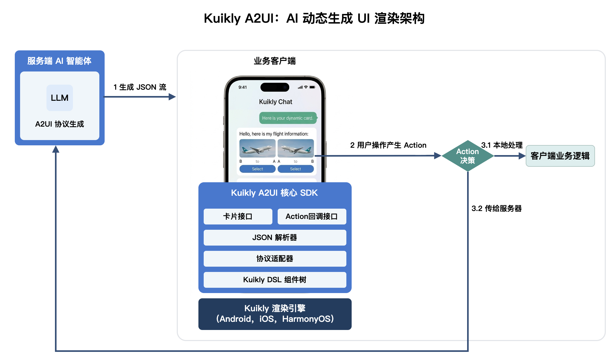

# KuiklyUI-A2UI

<p align="center">

[](https://github.com/Tencent-TDS/KuiklyUI-A2UI)
[](https://github.com/Tencent-TDS/KuiklyUI-A2UI/pulls)

</p>

English | [简体中文](./README-zh_CN.md) | [Homepage](https://framework.tds.qq.com/)

## Introduction

With the widespread adoption of AI large models, much of the content shown in chat/conversation scenarios is generated by LLMs. To replace plain generated text with richer, interactive UI, the [A2UI protocol](https://a2ui.org/) lets server-side AI produce structured JSON that describes UI cards dynamically, and clients render card UIs according to that JSON-defined UI tree.

**Kuikly A2UI leverages Kuikly’s proven rendering capabilities and performance to implement native A2UI rendering on Android, iOS, and HarmonyOS, while extending UI expressiveness and custom-component capabilities.**

The Kuikly A2UI core SDK provides end-to-end capability from JSON stream to rendered UI cards, plus Action callbacks generated by user interaction. After integration, business apps can connect three parties: server-side AI agent, app client, and Kuikly A2UI SDK. The server AI agent outputs JSON streams to the app client, then to Kuikly A2UI SDK for rendering; when users interact with cards, Action callbacks are sent to the app client, which decides whether to handle locally or forward to the server AI agent; after receiving Actions, the server AI agent can generate new JSON streams to render updated UI cards.

Inside the Kuikly A2UI core SDK, the pipeline plugs directly into the Kuikly DSL component tree and converts server-delivered JSON protocol into a native view tree managed by Kuikly Core, achieving true “server-driven UI”. The full internal flow is: protocol → internal message → DSL operations → native view.

<div style="display: inline-block; text-align: center; margin-left: 20px;">
  
</div>

**KuiklyUI-A2UI** is the implementation repository of the Kuikly A2UI core SDK, aiming to provide a cross-platform, easy-to-use, flexible UI development framework for user ↔ AI-agent interaction. Currently supported platforms:

- [X] Android
- [X] iOS
- [X] HarmonyOS

> **Terminology**: throughout this document, “**A2UI**” refers to the [A2UI protocol](https://a2ui.org/) open-sourced by Google; “**KuiklyUI-A2UI**” or “this project” refers to this repository (the Kuikly implementation of the A2UI protocol).

### Key Features

- **Server-driven**: UI structure and styling are fully described by a JSON message stream — no client-side release required to update the interface
- **Native rendering**: directly plugs into the Kuikly DSL component tree, reusing Kuikly Core's native rendering engine, with performance on par with native
- **Stream parsing**: supports JSON stream transport and incremental parsing, tailored for AI-LLM streaming output scenarios
- **Automatic layout**: reuses Kuikly Core's built-in FlexBox layout engine — no extra layout-calculation logic required
- **Action mechanism**: complete user-interaction event pipeline, supporting both server-side events and local function calls
- **Multiple page-integration modes**: can be embedded either as a native View (`A2UISurfaceView`) into an Activity / UIViewController / ArkTS page, or as a DSL component (`A2UISurface { }`) into a Kuikly Pager; both can co-exist in a single app
- **Custom function extension**: client-registered business functions can be invoked from property bindings and Actions in the JSON protocol ([guide](docs/A2UI_CUSTOM_FUNCTION_GUIDE.md))
- **Custom component extension**: client-registered native custom components (WebView, maps, charts, …) can be referenced directly from the JSON protocol and participate in FlexBox layout ([guide](docs/A2UI_CUSTOM_COMPONENT_GUIDE.md))
- **Custom Icon image extension**: clients can substitute business images for the default character rendering with no server-side JSON changes ([guide](docs/A2UI_CUSTOM_ICON_GUIDE.md))
- **Content-driven sizing**: container height is determined automatically from content layout (WRAP_CONTENT semantics)
- **Cross-platform**: built on Kotlin Multiplatform, a single core codebase powers Android, iOS, and HarmonyOS

### Two Kinds of Components

Within a single A2UI Surface you can **freely mix** two kinds of components, each playing to its strengths:

| Component family | Purpose | Examples |
|---|---|---|
| **A2UI protocol standard components (with the Kuikly `styles` extension)** | AI-generated, cross-platform standard protocol | `Text` / `Image` / `Button` / `Card` / `Column` / `Row` / `Tabs` / ... |
| **Business custom components** | Platform-specific capabilities such as WebView / maps / charts | `A2UIWeb` / `A2UIChart` / `A2UIMap` |

Standard components describe business semantics through the A2UI v0.9 spec (`component` / `text` / `align` / `justify` / `action`, …) and optionally expose Kuikly's native presentation layer via the `styles` field. Business custom components hold platform-native capabilities and participate in FlexBox layout through the Shadow mechanism — see the [custom component guide](docs/A2UI_CUSTOM_COMPONENT_GUIDE.md) for details.

---

## Protocol Extension: the `styles` Field

The Kuikly A2UI catalog lives at [`catalogs/kuikly_a2ui_catalog.json`](catalogs/kuikly_a2ui_catalog.json). It reuses each component definition from the A2UI v0.9 official catalog via `allOf`, and then appends an **optional** `styles` property bag. **When `styles` is absent the protocol remains pure v0.9** with consistent behaviour across platforms — plain official v0.9 JSON runs unchanged in Kuikly A2UI; adding `styles` unlocks Kuikly's full native presentation layer.

`styles` is split into two schemas:

| Schema fragment | Applies to | Contents |
|-------------|---------|------|
| `KuiklyCommonStyles` | 17 components (all except `Text`) | size / Flex / margin / padding / background / border / opacity / shadow / transform / absolute positioning |
| `KuiklyTextStyles` | `Text` only | On top of `KuiklyCommonStyles`, adds 13 text-specific fields such as font, text decoration, textShadow, … |

> **Note**: fields whose semantics overlap with A2UI protocol-level fields (`id` / `action` / `accessibility` / `touchEnable`) are deliberately excluded from `styles` to avoid ambiguity.

### Typical `KuiklyCommonStyles` fields

The list below is grouped by function. **Full definitions** (including `oneOf` struct forms, patterns, enums, and defaults) are authoritative in [`catalogs/kuikly_a2ui_catalog.json`](catalogs/kuikly_a2ui_catalog.json).

| Group | Typical fields | Purpose |
|------|---------|------|
| **Size** | `width` / `height` / `minWidth` / `minHeight` / `maxWidth` / `maxHeight` | Explicit size constraints (dp/pt) |
| **Flex** | `flex` / `flexGrow` / `flexShrink` / `flexBasis` / `alignSelf` | Participation in parent Flex allocation (`alignSelf: auto\|flex-start\|flex-end\|center\|stretch\|baseline`) |
| **Margin** | `margin` / `marginTop` / `marginBottom` / `marginLeft` / `marginRight` | Outer margins |
| **Padding** | `padding` / `paddingTop` / `paddingBottom` / `paddingLeft` / `paddingRight` | Inner padding |
| **Background & gradient** | `backgroundColor` / `backgroundLinearGradient` | Solid color (CSS hex) or a structured linear gradient (`direction` + `colorStops[]`) |
| **Border** | `borderWidth` / `borderColor` / `borderStyle` / `borderRadius` | Border width / color / style (`solid\|dotted\|dashed`) + corner radius |
| **Opacity & visibility** | `opacity` / `visibility` / `overflow` / `zIndex` | Common in overlay / clipping scenarios |
| **Shadow** | `boxShadow` | Structured: `offsetX` / `offsetY` / `radius` / `color` / `fill` (`fill:true` = inner shadow) |
| **Transform** | `transform` | Structured: `rotate` / `scale` / `translate` / `anchor` / `skew` / `rotateXY`; `translate` is a ratio relative to the element's own frame |
| **Absolute positioning** | `positionType` / `top` / `left` / `bottom` / `right` | With `positionType: absolute`, offsets are relative to the nearest positioned ancestor |

### `KuiklyTextStyles` — Text-only fields

| Group | Typical fields | Notes |
|------|---------|------|
| **Font** | `fontSize` / `color` / `fontWeight` / `fontStyle` / `fontFamily` | `fontWeight` accepts `normal\|light\|medium\|semibold\|bold` or 300-900 |
| **Alignment** | `textAlign` | `left\|center\|right` |
| **Decoration** | `textDecoration` | `none\|underline\|line-through` |
| **Line & letter spacing** | `lineHeight` / `lineSpacing` / `letterSpacing` / `firstLineHeadIndent` | Fine typography control |
| **Multi-line** | `numberOfLines` | Maximum number of lines (ellipsized beyond) |
| **Text shadow** | `textShadow` | `{ offsetX, offsetY, radius, color }` |

### Example: a weather card using `styles`

```json
{
  "version": "v0.9",
  "updateComponents": {
    "surfaceId": "weather-card",
    "components": [
      {
        "id": "root", "component": "Card", "child": "outer",
        "styles": {
          "padding": 10,
          "backgroundLinearGradient": {
            "direction": "to-bottom",
            "colorStops": [
              { "color": "#3A6DF0", "stop": 0.0 },
              { "color": "#7A3FD8", "stop": 1.0 }
            ]
          }
        }
      },
      { "id": "outer", "component": "Column", "align": "stretch", "children": ["title", "temp"] },
      {
        "id": "title", "component": "Text", "text": "Shenzhen · Today's Weather",
        "styles": {
          "color": "#FFFFFF", "fontSize": 15, "fontWeight": "medium",
          "letterSpacing": 1, "textAlign": "center"
        }
      },
      {
        "id": "temp", "component": "Text", "text": "27°",
        "styles": {
          "color": "#FFFFFF", "fontSize": 84, "fontWeight": "light",
          "textShadow": { "offsetX": 0, "offsetY": 2, "radius": 12, "color": "#66000000" }
        }
      }
    ]
  }
}
```

---

## Directory Layout

```
KuiklyUI-A2UI/                             # Project root (this repo)
├── a2ui/                                  # Core cross-platform module (Kotlin Multiplatform)
│   └── src/commonMain/kotlin/com/tencent/kuikly/a2ui/
│       ├── adapter/                       # Protocol adapters
│       │   ├── A2UIProtocolAdapter.kt        # Core protocol adaptation (data binding, component mapping)
│       │   └── A2UIComponentMapper.kt        # A2UI v0.9 components + Kuikly `styles` mapping
│       ├── bridge/                        # Native ↔ Kotlin bridge
│       ├── dsl/                           # Kuikly DSL binding layer (core)
│       │   ├── A2UIPager.kt                  # Kuikly Pager container (content-driven height)
│       │   ├── A2UIDSLBridge.kt              # DSL bridge
│       │   ├── A2UIApplier.kt                # Component-tree operations
│       │   └── embed/
│       │       ├── A2UISurface.kt            # DSL component (for Kuikly-page embedding)
│       │       └── A2UISurfaceDSLView.kt     # View backing the DSL component
│       ├── parser/                        # JSON stream parser
│       └── protocol/                      # Protocol data models
│
├── a2ui-render-android/                   # Android render module (A2UISurfaceView)
├── a2ui-render-ios/                       # iOS render module (A2UISurfaceView)
├── a2ui-render-ohos/                      # HarmonyOS render module (A2UISurfaceView)
│
├── catalogs/                              # Protocol catalog
│   └── kuikly_a2ui_catalog.json           # Full schema for v0.9 + Kuikly `styles` extension
│
├── demo/                                  # Business KMP sample module (@Page samples)
│
├── androidAppForNativePage/               # Android sample: native-page integration
├── androidAppForKuiklyPage/               # Android sample: Kuikly-page integration
├── androidAppForBothPages/                # Android sample: both integrations in one app
├── androidAppForTest/                     # Android protocol & feature test app
├── iosAppForNativePage/                   # iOS sample: native-page integration
├── iosAppForKuiklyPage/                   # iOS sample: Kuikly-page integration
├── iosAppForBothPages/                    # iOS sample: both integrations in one app
├── iosAppForTest/                         # iOS protocol & feature test app
├── ohosAppForNativePage/                  # HarmonyOS sample: native-page integration
├── ohosAppForKuiklyPage/                  # HarmonyOS sample: Kuikly-page integration
├── ohosAppForBothPages/                   # HarmonyOS sample: both integrations in one app
├── ohosAppForTest/                        # HarmonyOS protocol & feature test app
│
├── buildSrc/                              # Gradle plugin & constants (version numbers, …)
├── scripts/                               # Project scaffolding scripts (incl. link-kuikly.sh)
├── publish/                               # Publishing scripts & compatibility patch config
├── gradle.properties                      # Project-wide config (e.g. kuikly.projectDir)
├── local.properties.example               # Per-machine override template
├── settings.gradle.kts                    # Mainline 2.1.21 settings
├── settings.2.0.ohos.gradle.kts           # HarmonyOS 2.0 compatibility settings
├── build.2.1.21.gradle.kts / build.2.0.ohos.gradle.kts   # Dual buildfiles
└── 2.0_a2ui_ohos_build{,_release}.sh      # HarmonyOS build scripts
```

> **Dependency mode**: by default the project consumes KuiklyUI Core as **local source** (`kuikly.projectDir` points at an external KuiklyUI checkout, defaulting to `../KuiklyUI`); switching to Maven artefacts is also supported. See [`SETUP.md`](SETUP.md) for details.

---

## Architecture Overview

A2UI adopts an architecture that **plugs directly into the Kuikly DSL component tree**. After the JSON protocol is parsed and adapted, it operates the Kuikly Core component tree directly, and Kuikly Core takes care of layout calculation and native rendering uniformly:

```
┌─────────────────────────────────────────────────────────┐
│                    Server / AI Model                      │
│              (generates JSON message stream)              │
└────────────────────────┬────────────────────────────────┘
                         │ JSON Stream
                         ▼
┌─────────────────────────────────────────────────────────┐
│              A2UI Core (Kotlin Multiplatform)             │
│                                                          │
│  ┌──────────────┐  ┌──────────────┐  ┌──────────────┐  │
│  │ StreamParser  │→ │  DSLBridge   │→ │ProtocolAdapter│  │
│  │ (stream parse)│  │(msg routing) │  │(proto adapt) │  │
│  └──────────────┘  └──────────────┘  └──────────────┘  │
│                              │                           │
│                              ▼                           │
│  ┌──────────────────────────────────────────────────┐   │
│  │           A2UIApplier (component-tree ops)         │   │
│  │  createComponent / updateComponent / removeComponent │ │
│  └──────────────────────────┬───────────────────────┘   │
│                              │                           │
│                              ▼                           │
│  ┌──────────────────────────────────────────────────┐   │
│  │  A2UIPager  or  Flex tree embedded in host Kuikly Pager │
│  │  ┌─────────────────────────────────────────────┐ │   │
│  │  │     Kuikly DSL Component Tree               │ │   │
│  │  └─────────────────────────────────────────────┘ │   │
│  └──────────────────────────┬───────────────────────┘   │
│                              │                           │
│  ┌──────────────────────────────────────────────────┐   │
│  │        Kuikly Core (auto layout + rendering)       │   │
│  │  • FlexNode layout    • RenderView creation        │   │
│  │  • Text measurement   • Component lifecycle mgmt   │   │
│  └──────────────────────────┬───────────────────────┘   │
└─────────────────────────────┼───────────────────────────┘
                              │ NativeBridge
                              ▼
┌─────────────────────────────────────────────────────────┐
│            Platform Render Layer (native rendering)       │
│                                                          │
│  Android: A2UISurfaceView / A2UISurface { }             │
│  iOS:     A2UISurfaceView / A2UISurface { }             │
│  HarmonyOS: A2UISurfaceView / A2UISurface { }           │
└─────────────────────────────────────────────────────────┘
```

### Core Design Decisions

| Decision | Notes |
|--------|------|
| **Layout** | Fully handled by Kuikly Core's FlexNode engine; A2UI performs no manual layout |
| **Text measurement** | Reuses RichTextView's built-in TextShadow; no custom MeasureFunction required |
| **Container height** | Content-driven (WRAP_CONTENT); width is constrained externally, height is reported back by the Flex engine |
| **Render pipeline** | Render instructions are pushed through Kuikly Core's standard NativeBridge, sharing the render layer with Kuikly DSL pages |
| **Data binding** | `path` references and function-call bindings are handled inside `A2UIProtocolAdapter` |
| **Protocol extension** | The `styles` field is appended via catalog `allOf`, so standard v0.9 JSON runs unmodified |

---

## Three Page-Integration Modes

A2UI supports three page-integration modes, each with its own dedicated guide:

| Mode | Host form | When to choose | Doc |
|---------|---------|--------|------|
| **Native-page integration** | Native `Activity` / `UIViewController` / ArkTS `@Entry` | Host is a pure native page | [A2UI_INTEGRATION_NATIVE_PAGE.md](docs/A2UI_INTEGRATION_NATIVE_PAGE.md) |
| **Kuikly-page integration** | Kuikly Pager (`@Page`-annotated DSL page) | Host page is a Kuikly DSL page and you want to embed an A2UI subtree that shares a single Flex layout tree | [A2UI_INTEGRATION_KUIKLY_PAGE.md](docs/A2UI_INTEGRATION_KUIKLY_PAGE.md) |
| **Both page types in one app** | Some pages native, some Kuikly | Incremental migration, mixed UI stack | [A2UI_INTEGRATION_BOTH_PAGES.md](docs/A2UI_INTEGRATION_BOTH_PAGES.md) |

### Minimal Hello World

**Native-page integration** (Android example):

```kotlin
val surface = A2UISurfaceView(this)
surface.init("{}")
surface.setListener(myListener)

surface.writeStream("""{"version":"v0.9","createSurface":{"surfaceId":"hi"}}""")
surface.writeStream("""{"version":"v0.9","updateComponents":{"surfaceId":"hi","components":[
    {"id":"root","component":"Text","text":"Hello A2UI!",
     "styles":{"fontSize":20,"color":"#333333"}}
]}}""")
surface.finishStream()
```

**Kuikly-page integration** (Kotlin DSL example):

```kotlin
@Page("MyKuiklyPage")
class MyKuiklyPage : Pager() {
    private var surface: A2UISurfaceDSLView? = null
    override fun body() = ViewBuilder {
        A2UISurface {
            surface = this
            attr { flex(1f) }
            event { action { _, _, actionJson -> /* … */ } }
        }
    }
    fun onChunk(chunk: String) { surface?.writeStream(chunk) }
    fun onDone() { surface?.finishStream() }
}
```

iOS / HarmonyOS APIs are **semantically identical** to Android (`initSurface` / `writeStream` / `finishStream`). See the corresponding integration guide for full details.

---

## Integration Documentation

### Integration Guides

| Doc | Description |
|------|------|
| [Native-page integration guide](docs/A2UI_INTEGRATION_NATIVE_PAGE.md) | Integration flow (all three platforms) when the host is a native `Activity` / `UIViewController` / ArkTS page |
| [Kuikly-page integration guide](docs/A2UI_INTEGRATION_KUIKLY_PAGE.md) | Integration flow (all three platforms) when the host is a Kuikly Pager (DSL page) |
| [Both-page-types integration guide](docs/A2UI_INTEGRATION_BOTH_PAGES.md) | Dependency-merging and platform pitfalls when both page types co-exist in one app |

### Custom Extensions

| Doc | Description |
|------|------|
| [Custom function guide](docs/A2UI_CUSTOM_FUNCTION_GUIDE.md) | JSON protocol format for custom functions, cross-platform registration API, complete examples |
| [Custom component guide](docs/A2UI_CUSTOM_COMPONENT_GUIDE.md) | Custom-component internals, Shadow-based measurement, cross-platform registration API, demo pointers |
| [Custom Icon guide](docs/A2UI_CUSTOM_ICON_GUIDE.md) | Icon resource conventions, cross-platform registration API, fallback strategy |

### Under the Hood

| Doc | Description |
|------|------|
| [Implementation design](docs/A2UI_KUIKLY_IMPLEMENTATION_DESIGN.md) | A2UI core architecture, implementation details, extension guidance |
| [Protocol catalog (schema)](catalogs/kuikly_a2ui_catalog.json) | Full JSON Schema for v0.9 + the Kuikly `styles` extension |

---

## Demo Experience

### Runtime Showcase

Built-in demos are provided for Android / iOS / HarmonyOS:

- **Card integration demo**: loads JSON strings to render A2UI cards, and simulates dynamic card generation by clicking an add button. Includes samples like flight status cards, schedule cards, weather cards, product cards, etc.

<div style="display: inline-block; text-align: center; margin-left: 30px;">
  
</div>

- **Component gallery**: full coverage of all 18 standard components defined by A2UI protocol v0.9 (Text / Image / Button / Card / Column / Row / List / Tabs / Slider / CheckBox / ChoicePicker / DateTimeInput / TextField / Video / AudioPlayer / Modal / Divider / Icon)

<div style="display: inline-block; text-align: center; margin-left: 30px;">
  
</div>

- **Custom component examples**: demonstrates custom Web component and custom simple View component.
- **Custom function examples**: demonstrates multiple examples of invoking custom functions in A2UI JSON.
- **Custom Icon image examples**: demonstrates replacing all default Icon component glyphs with app-defined icon images.

### Quick Try

<div style="display: inline-block; text-align: center; margin-left: 30px;">
  
</div>

Android users can scan and try quickly. For iPhone and HarmonyOS phones, follow the source build steps below to run the demo app.

### Build from Source

The repository ships 3 × 4 = 12 sample projects covering 3 platforms (Android / iOS / HarmonyOS) × 4 flavours (native-page integration / Kuikly-page integration / both / protocol test).

**Prerequisite**: this project depends on an external KuiklyUI Core checkout, with the default path configured as `../KuiklyUI`. The simplest source-dependency setup is to clone the [KuiklyUI](https://github.com/Tencent-TDS/KuiklyUI) `main` branch into a directory alongside KuiklyUI-A2UI. For detailed dependency configuration, see [`SETUP.md`](SETUP.md), and adjust `kuikly.projectDir` in `gradle.properties` as needed (or override it in `local.properties`).

Then run any demo per platform:

```bash
# Android — pick any sample
./gradlew :androidAppForNativePage:installDebug
./gradlew :androidAppForKuiklyPage:installDebug
./gradlew :androidAppForBothPages:installDebug
./gradlew :androidAppForTest:installDebug

# iOS — pick any sample
cd iosAppForNativePage && bash setup.sh && open A2UIDemoApp.xcworkspace
cd iosAppForKuiklyPage && bash setup.sh && open A2UIDemoApp.xcworkspace
cd iosAppForBothPages  && bash setup.sh && open A2UIDemoApp.xcworkspace
cd iosAppForTest       && bash setup.sh && open A2UIDemoApp.xcworkspace

# HarmonyOS — first run the build script from the project root to produce
# libshared.so into each ohosAppFor* module:
./2.0_a2ui_ohos_build.sh          # Debug build
./2.0_a2ui_ohos_build_release.sh  # Release build
# Then open the corresponding directory in DevEco Studio and run:
# ohosAppForNativePage / ohosAppForKuiklyPage / ohosAppForBothPages / ohosAppForTest
```

---

## Core Modules

### A2UIBridgeManager (entry-point manager)

The unified entry point at the Kotlin Common layer, managing the lifecycle of every A2UI instance:

| Method | Purpose |
|------|------|
| `callKotlinMethod(INIT, ...)` | Create instance; initialize DSL bridge and Pager |
| `callKotlinMethod(WRITE_STREAM, ...)` | Feed JSON stream chunks |
| `callKotlinMethod(FINISH_STREAM, ...)` | Mark end-of-stream; trigger final layout |
| `callKotlinMethod(SET_SURFACE_SIZE, ...)` | Set container width/height constraints |
| `callKotlinMethod(VIEW_CLICK, ...)` | Handle user click events |
| `callKotlinMethod(DESTROY, ...)` | Destroy instance and free resources |

### A2UIDSLBridge (DSL bridge layer)

Wires StreamParser to Applier and is responsible for:

- Creating and managing `A2UIPager` (the Kuikly Pager container)
- Routing parsed JSON messages to `A2UIApplier`
- Managing `A2UIProtocolAdapter` (protocol adaptation)
- Reporting content-height changes back to the host

### A2UIApplier (component-tree operations)

Translates JSON protocol operations into Kuikly DSL component-tree operations:

- `createComponent()` — create a DSL component and insert it into the tree
- `updateComponent()` — update component attributes (via the `attr {}` DSL)
- `removeComponent()` — remove a component from the tree
- `performLayout()` — trigger layout calculation and report content height

### A2UIPager (Kuikly Pager container)

Extends Kuikly `Pager` and serves as the root container of the A2UI component tree:

- Width is constrained externally (`setSurfaceWidth()`)
- Height is content-driven (`flexNode.styleHeight = Float.NaN`)
- After layout, reports actual content height via `onContentHeightChanged`
- Maintains a tag → view lookup map to support tag-based component lookup

### A2UIProtocolAdapter (protocol adapter)

Handles A2UI v0.9 + Kuikly `styles`-extended protocol:

- **Data binding**: resolves `{"path": "/xxx"}` references and re-evaluates on `updateDataModel`
- **Component mapping**: maps v0.9 standard components (Text/Image/Button …) to Kuikly components
- **`styles` application**: converts `KuiklyCommonStyles` / `KuiklyTextStyles` into native Kuikly attributes
- **Action registration**: collects component `action` properties and builds a tag → action map

---

## Threading Model

| Thread | Responsibility |
|------|------|
| **Main Thread** | UI rendering, View creation/update, user-interaction events |
| **Context Queue** | Kotlin logic execution, JSON parsing, DSL component-tree operations, layout calculation |

- `writeStream` / `finishStream` dispatch tasks onto the Context Queue
- After Kuikly Core finishes layout on the Context Queue, it batch-submits render instructions to the Main Thread via `FLUSH_UI_TASKS`
- User taps and other interactions fire on the Main Thread and are bridged back to the Context Queue for handling
- All DSL component-tree operations (`attr {}`, `addChild`) must run on the Context Queue

---

## Version Information

- **Semantic version**: `0.9.0-SNAPSHOT` (used for iOS pod, HarmonyOS ohpm, and README display)
- **Android/KMP Maven coordinates**: `0.9.0-2.1.21-SNAPSHOT` by default (Kotlin `2.1.21`); the HarmonyOS-compatible build is `0.9.0-2.0.21-ohos-SNAPSHOT`. This follows KuiklyUI Core's coordinate convention; both version strings are generated by [`buildSrc/src/main/java/A2uiVersion.kt`](buildSrc/src/main/java/A2uiVersion.kt)
- **KuiklyUI Core dependency version**: 2.1.21 mainline (the HarmonyOS 2.0 compatibility build uses 2.0.21-KBA-010, see `settings.2.0.ohos.gradle.kts`)
- **Minimum Android SDK**: API 21 (Android 5.0)
- **Minimum iOS**: 15.0
- **HarmonyOS**: API 12 and above (DevEco Studio 4.1+)
- **Kotlin**: 2.1.21
- **Gradle**: 7.6.3 (temporarily switched to 8.0 under the HarmonyOS 2.0 compatibility build via `publish/FileReplacer` patches)
- **JDK**: 17+

> Dependency strategy and version-override mechanics are documented in [`SETUP.md`](SETUP.md).

---

## License

KuiklyUI-A2UI License. See [LICENSE](LICENSE) for details.

Some example JSON assets bundled in this project's demos are derived from Google LLC's A2UI project (Apache License 2.0); attribution and file inventory are listed in [THIRD_PARTY_LICENSES](THIRD_PARTY_LICENSES).
