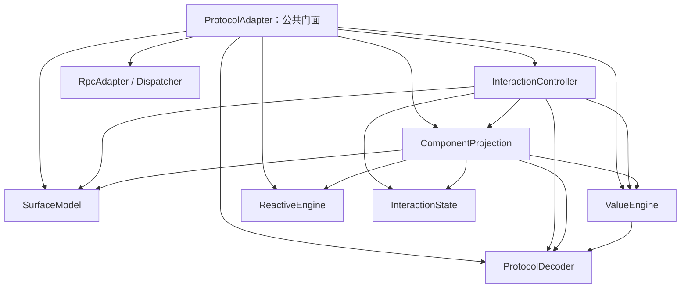

# A2UI Adapter 拆分架构

> 实现与验证快照：2026-11-19。本文描述本轮重构后的实际实现，不是尚未落地的理想设计。源码位于 `a2ui/src/commonMain/kotlin/com/tencent/kuikly/a2ui/adapter/`。

## 1. 重构目标与结果

原 `A2UIProtocolAdapter.kt` 同时承担协议解释、数据模型、求值、依赖登记、树构建、模板实例化、控件交互和 RPC 接线。仅抽出路径、颜色、格式化等叶子算法后，文件仍约 6860 行，核心耦合并未消除。

本轮按职责与状态所有权拆为 **六个职责模块＋一个公共薄门面**。当前 `A2UIProtocolAdapter.kt` 为 136 行，公共入口已真实委托到新模块，不保留旧核心实现作为备用路径。

核心目标：

- 协议事实、响应式索引、投影身份和本地交互状态有明确所有者。
- 求值只返回结果与依赖，不接收组件身份，不直接写订阅表。
- 属性计算与状态提交分离，提交不重复调用真实宿主函数。
- 下层不依赖、继承或回调 Adapter，不通过通用上下文暴露全部可变 Map。
- 保留公共 API、协议消息顺序、RPC 热替换、生命周期和 golden 行为；不夹带遗留行为修复。

## 2. 模块与文件职责

| 模块 | 实现文件 | 负责 | 不负责 |
| --- | --- | --- | --- |
| 公共薄门面 | `A2UIProtocolAdapter.kt` | 公共 API、模块组装、命令执行顺序、流结束、reset 与 RPC 委托 | 属性算法、实例化算法、主要状态表 |
| 协议解码 | `A2UIProtocolDecoder.kt` | 版本协商、严格模式校验、mixin key 读取、转义与内部命令生成 | 模型写入、视图消息生成、RPC 执行或 tick |
| Surface 事实模型 | `A2UISurfaceModel.kt` | 单 active surface 数据、定义、父子关系、variant 与 catalog 索引 | tag、物化节点、订阅和交互意图 |
| 求值引擎 | `A2UIValueEngine.kt` | 普通/scoped 求值、动态参数、格式化函数、checks、action 动态值、custom function 编码与返回值转换 | 组件身份、依赖订阅表、视图更新 |
| 响应式引擎 | `A2UIReactiveEngine.kt` | 路径/函数/checks 索引、校验规则、变更影响计算 | 数据写入、表达式求值、视图生成 |
| 组件投影 | `A2UIComponentProjection.kt` 及扩展文件 | 属性、树结构、辅助节点、模板实例、视觉变化和物化输出状态 | 用户选择决策、action 分发与本地选择/打开状态所有权 |
| 交互控制 | `A2UIInteractionController.kt` | 双向绑定、ChoicePicker 选择、Tabs 切换、Modal 开关意图、action 实时解析 | tag 分配、辅助节点构建、overlay 移除算法 |

### 2.1 投影模块的内部组织

以下文件是同一个投影模块的内部扩展，不是各自独立的服务：

| 文件 | 内容 |
| --- | --- |
| `A2UIProjectionStructure.kt` | `handleUpdateComponents()`、批处理与父子结构、组件创建/更新和辅助结构 |
| `A2UIProjectionProperties.kt` | `computeProperties()`、`computeKuiklyProperties()`、`computeScopedProperties()`、布局、label 与 accessibility |
| `A2UIProjectionTemplates.kt` | ChildList 展开、子树实例化、scope/index、实例复用与清理 |
| `A2UIProjectionInteractions.kt` | ChoicePicker/Tab 视觉更新、Modal overlay 与懒创建内容；不是交互意图所有者 |
| `A2UIProjectionPlan.kt` | 属性计划、暂存草稿、属性提交、消息批提交及物化状态 |

### 2.2 支持模块

- `A2UIAdapterModels.kt`：`ChildListBinding`、`TabDefinition`、`ModalDefinition` 等共享结构。
- `A2UIDataPath.kt`：路径解析、读取、写入，保留原路径兼容语义。
- `A2UIColorSupport.kt`：颜色归一化、ARGB 转换、Card 默认值与渐变清理。
- `A2UIValueFormatting.kt`：日期、数字、插值边界和参数词法切分等叶子算法。
- `A2UIJsonValue.kt`：action、数据快照与 wire JSON 序列化；custom function 参数编码仍保留自身契约。
- `A2UIRpcAdapter.kt`：RPC envelope 解析、dispatcher 分发和出站序列化，不拥有流生命周期。

## 3. 依赖方向与状态所有权

图中的边表示主要运行时依赖。`ProtocolDecoder` 另外通过门面注入的 getter 读取当前 surface ID，不持有模型或 Adapter 引用。叶子工具和注册表依赖未逐一画出。

| 状态类别 | 所有者 | 示例 |
| --- | --- | --- |
| 协议解释状态 | `A2UIProtocolDecoder` | 当前版本、expected version、strict 配置、去重诊断 |
| 协议事实及衍生关系索引 | `A2UISurfaceModel` | data、definitions、原始/本批父子关系、variant、catalog、surface ID、primaryColor、sendDataModel |
| 响应式状态 | `A2UIReactiveEngine` | 路径、函数、checks 依赖和校验规则 |
| 投影身份与辅助结构 | `A2UIComponentProjection` | `idToTag`、组件类型、children、label/check wrapper、chip/header/overlay tags |
| 模板状态 | `A2UIComponentProjection` | ChildList binding、generated instance、item snapshot、scope path、index stack |
| 已输出的物化存在 | `A2UIMaterializationState` | tag 是否已创建、创建时 parent tag |
| 本地交互状态 | `A2UIInteractionState` | action、disabled guard、Tab index、Modal open set |
| 单次属性计算暂存 | `A2UIProjectionDraft` | props 依赖、定义、action、checks、初始化意图 |
| RPC 生命周期状态 | `A2UIRpcDispatcher`，由门面组装 | pending request、完成与取消 |

`A2UIInteractionState` 的底层表私有。控制器执行选择/开关决策；投影经专用 API 初始化 Tab、读取选择、登记 action 与 disabled 状态。两者共享的是窄职责状态对象，不是全局可变上下文。

模型对外提供只读类型查询与明确变更方法；这不是深不可变快照，内部及嵌套数据仍可能是可变容器。不要将查询结果强转为可变 Map 来绕开所有权。

## 4. 协议与更新执行链路

### 4.1 单 envelope

1. `convertMessage()` 调用 `decoder.decode()`，协商版本并执行 envelope 校验。
2. 解码结果为 `A2UIDecodedEnvelope`，含按顺序排列的 `A2UICommand`；命令携带原 payload，并非完全规范化的组件 IR。
3. v0.9/v0.9.1 顺序为 CREATE → COMPONENTS → DATA；v1.0 先处理四种 RPC key，再执行该结构/数据顺序。
4. 门面逐条分派：RPC 交给 `A2UIRpcAdapter`，创建、组件与数据交给投影处理。
5. 投影处理事实变更、求值与依赖、组件/辅助结构消息；属性创建路径使用计划与提交。
6. 分派结束后调用 `rpcDispatcher.tick()`，再通过 `commitBatch()` 更新物化输出记录并返回消息。

版本协商拒绝时 `decode()` 返回 null，门面直接返回，不执行 tick；版本专用校验产生空命令列表时，门面仍到达 tick。不得在重构中随意把这两条路径合并。

v1.0 的 inline components/dataModel 仍由 createSurface 投影路径展开；部分组件级与数据级校验仍位于投影，不能认为所有协议校验都已集中到 Decoder。

### 4.2 数据更新

- **WIRE**：`handleUpdateDataModel()` 写入模型，生成 `UPDATE_DATA`，展开 ChildList，再根据兼容规则计算刷新影响并生成属性/checks 更新。
- **BINDING**：控制器先 `model.write()`，将 `A2UIDataChange` 交给 `refreshBindingValue()`，最后提交消息批。
- **CHOICE**：控制器计算 toggle/replace 结果、写模型，投影更新 chip 样式，再刷新相关组件；无绑定时使用 `__cp_internal_${componentId}`。

`A2UIReactiveEngine.impact()` 统一影响计算，但保留来源策略：

| 来源 | 属性依赖查询 | 校验影响 |
| --- | --- | --- |
| WIRE | exact path ＋ root key | exact checks 订阅 ＋受影响组件自身的 checks |
| BINDING | exact path ＋ root key | exact checks 订阅 ＋受影响组件自身的 checks |
| CHOICE | root key | 不触发 checks |

例如更新 `person/name`：WIRE/BINDING 查询 `person/name` 与 `person`；CHOICE 只查询 `person`。ChoicePicker 自身仅从路径依赖集合排除，不从函数依赖集合排除。`__childlist__` 哨兵不进入普通组件影响集合，ChildList 由模板路径协调。

统一的是索引与影响规则，不是所有来源的完整渲染算法。WIRE 的 changed keys 仍按既有 payload 策略构造，不能直接假设等于 `model.write()` 返回的路径集合。

## 5. 求值契约与模板 scope

`A2UIEvaluationContext` 显式携带 `data`、可选 `item`、`index`、`catalogId`。

`evaluate()` 返回 `A2UIEvaluationResult`：

- `value`：最终值。
- `paths`：路径绑定依赖。
- `functions`：函数表达式依赖的路径集合，不是函数名订阅。
- `diagnostics`：本次求值记录的告警；当前包括 scope 外 `@index` 告警，同时保留原日志输出，不是所有协议诊断的统一集合。

每次创建独立 `A2UIEvaluationWorker`。普通 tracked 求值收集依赖；投影根据组件身份登记到 ReactiveEngine 或暂存 Draft。ValueEngine 不持有组件 ID/tag 或订阅表。

普通、scoped、checks、action 必须保留独立语义：

- 普通路径缺失通常降级为空字符串；普通不支持的 function call 也按显示场景回退。
- scoped 求值优先按绝对/相对规则读取；绝对路径缺失时保留 item fallback。当前 scoped 路径不沿用普通订阅登记方式，即使传入 tracked 也不会自动取得相同依赖集合。
- `function()` 保留不支持时返回 null 的契约；`action()` 对不支持的调用保留原 Map，留给宿主处理。
- `check()` 使用校验布尔语义，不能通过显示字符串的 truthy 转换替代。
- 模板 index 使用投影栈管理；嵌套 ChildList push/pop 保持最深 scope 的 `@index` 语义。

属性、checks 与 action 可能调用真实 custom function，求值不是完全无副作用的纯函数。不得双跑宿主调用来比较新旧结果。

## 6. 投影计划、提交与物化

### 6.1 属性计划

`planProperties()` 创建 `A2UIProjectionDraft`，执行标准、Kuikly 或 scoped 属性计算，最终形成 `A2UIProjectionPlan`。计划包括 props、路径/函数依赖、定义、action、disabled、checks 和初始值。

规划期间：

- 不直接写模型事实、动作表或订阅表；属性算法使用 `planDefinition()`、`planAction()`、`planDisabled()`、`planInitialValue()`。
- checks 使用草稿规则；初始值叠加到求值上下文，使校验能看到本次输入初始化，而真实模型尚未提交。
- `finally` 恢复上一层草稿。

`commitProperties()` 依次提交依赖、定义、action、disabled、初始值和 checks，返回已计算的 props，不重新求值。结构批处理、模板实例和 Modal 内容创建都使用这个边界。

宿主 custom function 回调经过 `withoutPendingProperties()`：暂时隔离外层草稿，避免同步重入的转换或绑定更新写入外层计划。该隔离不是跨线程安全或全事务保证。

### 6.2 消息批提交

`A2UIProjectionBatch` 保存有序消息。`commitBatch()` 仅按 CREATE/REMOVE 更新 `A2UIMaterializationState` 的存在与父节点记录，原样返回消息，不执行宿主渲染或保存全量视图属性。

必须区分三种状态：

1. **已定义**：模型中有原始组件定义。
2. **已分配身份**：投影中有 ID→tag。
3. **已物化输出**：已提交 CREATE 且尚未提交 REMOVE。

模板或关闭 Modal 的内容可能已定义/已分配 tag，但没有创建输出。REMOVE 也不意味着自动删掉原始定义或已分配身份。

这里的“物化”是适配器输出层记录，不是宿主真实挂载 ACK。辅助节点及结构消息仍由结构/模板/Modal 算法生成，不属于属性计划内的全树事务。规划失败、宿主失败和重入 reset 尚无统一回滚机制。

## 7. 交互、公共 API 与 RPC

### 7.1 交互

- `getActionForTag()` 先检查 disabled guard，再按当前模型解析 action 并序列化；不缓存首次渲染时的数据 JSON。
- ChoicePicker 控制器负责单选/多选决策；投影负责 chip/checkbox 样式和依赖组件视觉变化。过滤入口不改变选择数据。
- Tabs 控制器校验目标 index 并更新本地选择；投影更新内容可见性、标题与下划线。
- Modal 控制器校验定义/打开状态；投影懒创建 overlay、内容与内部模板，关闭按创建逆序生成 REMOVE，子节点先于父节点。
- 交互产生的视觉消息也通过 `commitBatch()`，不重新实现 tag 与物化表。

### 7.2 门面兼容接口

| 类别 | 保留接口 |
| --- | --- |
| 协议与生命周期 | `protocolVersion`、`strictV10`、`sendDataModel`、`setExpectedProtocolVersion()`、`convertMessage()`、`convertMessages()`、`reset()` |
| action/数据/checks | `getActionForTag()`、`getActionTags()`、`getDataModelSnapshot()`、`updateDataModelValue()`、`resolveDataBindings()`、`evaluateChecksForComponent()` |
| ChoicePicker | `filterChoicePickerOptions()`、`updateChoicePickerSelection()`、chip ID/value 与 binding path 查询 |
| Tabs/Modal | `switchTab()`、header ID/index 查询、`openModal()`、`closeModal()`、trigger 查询 |
| 宿主 internal 接线 | `customFunctionInvoker`、`rpcDispatcher`、`onIncomingAgentCall`、`emitWireMessage`、`respondToAgent()`、`failAgentRequest()`、`invokeAgentFunction()` |

无参构造与公共 `Companion` 保留。`resolveDataBindings()` 仍返回空列表，是原兼容入口，不表示全量刷新已经实现。

`convertMessages()` 按消息转换；仅在非空 surface ID 时追加 `STREAM_END`，不隐式 reset。

### 7.3 RPC

`A2UIRpcAdapter` 使用 getter 实时读取 surface ID、协议版本、strict 与宿主回调，因此初始化后替换 transport/handler 仍生效。门面持有原 dispatcher 实例，负责 tick 和 reset 取消；RPC 不生成普通视图消息。

custom function invoker 的公共接线同样允许热替换，值引擎取得包装后的调用器；action、checks、显示求值和 RPC 分发不能混用副作用策略。

## 8. reset 的兼容边界

门面顺序为：Projection → Interaction → Model → Reactive → Decoder → `rpcDispatcher.cancelAll(null)`。

| 所有者 | 清理 | 保留 |
| --- | --- | --- |
| Projection | ID/tag 类型、物化存在、ChildList binding、scope path、tag allocator、index stack | children、label/check 辅助表、ChoicePicker/Tabs/Modal 呈现表等原先未清理状态 |
| InteractionState | action 与 disabled guard | Tab 选择与 Modal open set |
| SurfaceModel | data、surface ID、sendDataModel、surface/per-component catalog | 定义、父子关系、variant 与 primaryColor |
| ReactiveEngine | checks 规则与 checks 依赖 | 路径/函数依赖 |
| Decoder | 默认版本、expected version、诊断去重集合 | strict 配置 |
| 门面/dispatcher | 取消全部 pending RPC | dispatcher 对象及宿主回调 |

这些保留范围是原实现兼容策略，不是推荐的全新生命周期设计。后续若治理跨 reset 残留，需要独立行为变更、明确迁移策略与特征测试，不能在结构整理中顺便“清干净”。

## 9. 维护约束与当前局限

### 必须遵守

1. 新功能先判断状态/职责归属，再选择文件；不要把核心算法重新塞入门面。
2. Model/Reactive 不持有 Projection/Controller，所有拆分文件不反向依赖 Adapter。
3. ValueEngine 不接收组件身份，不登记组件订阅；投影负责解释求值依赖与组件关联。
4. 新属性使用计划意图，提交阶段不重复调用宿主；新增初始化逻辑必须验证 checks 能看到规划值。
5. 新交互决策放 Controller，视觉构建放 Projection，共享状态只通过专用 API。
6. wire/binding/choice、scoped/普通求值、模板/Modal 延迟存在差异必须显式保留。
7. 结构重构不得更新 golden 基线掩盖差异；协议行为修改必须单独说明。

### 当前不是哪些能力

- 不是六个完全纯函数服务；投影内部仍有多个共享可变表，值求值仍可能调用宿主和注册表。
- 不是全树计划/事务，属性计划与结构消息批分开；物化记录不驱动所有旧刷新决策。
- 不是所有更新统一执行同一属性渲染流水线；目前统一了响应式索引与影响计算，来源渲染仍保留差异。
- 不是线程安全或深不可变模型，也未全面治理订阅残留、reset 遗留状态和只读嵌套 Map 写入边界。
- 正则架构守卫只能发现特定依赖/所有权回退，不能代替编译、动态行为和人工审查。

## 10. 验证与源码导航

### 10.1 本轮验证快照

本轮重构结束时已通过：87 个 Android JVM 单测、260 条 golden（基线未修改）、6 项架构守卫、iOS Simulator ARM64 编译、完整 harness verify。iOS 仅剩原有 bridge deprecated 与 cinterop opt-in 告警。

这是本轮结果，不是未来修改自动获得的保证；本文编写未重新执行构建。

### 10.2 验证入口

- 在 `KuiklyUI-A2UI/` 运行 `./gradlew :a2ui:testDebugUnitTest --quiet --console=plain`。
- 在 `KuiklyUI-A2UI/` 运行 `./gradlew :a2ui:compileKotlinIosSimulatorArm64 --quiet --console=plain`。
- 在 `ka2ui-harness/` 运行 `node --test scripts/adapter-architecture.test.mjs`。
- 在 `ka2ui-harness/` 运行 `node bin/ka2ui.mjs verify KuiklyUI-A2UI`，覆盖开源边界、schema、fixture、golden 管道、架构和 Android JVM 回归。

### 10.3 关键测试

测试目录：`a2ui/src/commonTest/kotlin/com/tencent/kuikly/a2ui/adapter/`。

| 文件 | 覆盖 |
| --- | --- |
| `A2UIAdapterExtractionTest.kt` | 叶子工具边界、Companion、RPC 热替换/重入/reset |
| `A2UIArchitectureStateTest.kt` | 模型/订阅独立所有权、来源影响范围、批关系查询与 reset |
| `A2UIInteractionArchitectureTest.kt` | ChoicePicker、Tab 本地状态、Modal 创建与移除顺序 |
| `A2UIProjectionArchitectureTest.kt` | 计划不写事实/action/订阅，初始化/checks，提交不双调用宿主，身份/物化分离，scope 差异、诊断、重入与回调替换、命令顺序 |

跨仓守卫位于 `ka2ui-harness/scripts/adapter-architecture.test.mjs`，由 `scripts/verify.mjs` 接入。守卫检查：六模块存在且无反向依赖、门面行数与算法/状态边界、底层依赖方向、值引擎无身份/订阅表、真实模块组装、投影不重持交互状态、属性规划无直接状态提交。

相关既有设计与宿主接线文档：[整体实现设计](A2UI_KUIKLY_IMPLEMENTATION_DESIGN.md)、[v1.0 迁移](A2UI_V10_MIGRATION.md)、[RPC 宿主集成](RPC_HOST_INTEGRATION.md)。本文只记录 Adapter 拆分边界，不替代协议规范与宿主接口文档。
