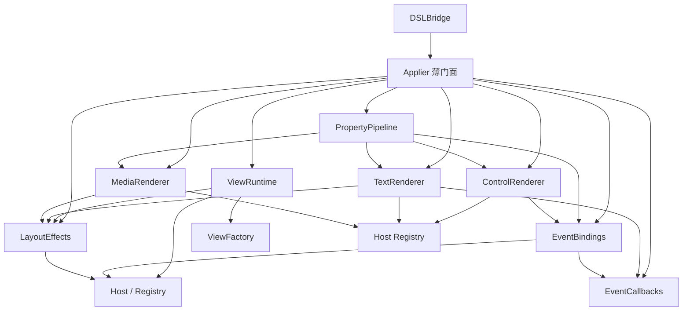

# A2UI Applier 拆分架构

> 实现与验证快照：2026-11-23。本文记录已落地的职责拆分、兼容约束和验证边界，不把后续治理建议描述为已实现能力。生产源码目录为 `a2ui/src/commonMain/kotlin/com/tencent/kuikly/a2ui/dsl/`。

## 1. 重构动机与结果

原 `A2UIApplier.kt` 共 2325 行，同时承担视图创建/删除、通用属性、文本与 Markdown、表单控件、事件绑定、媒体属性和后置布局。仅拆工具函数或将方法搬成扩展文件，无法解决共享状态和执行顺序耦合。

本轮按 **六个执行职责模块＋公共薄门面＋支持层** 拆分。`A2UIApplier.kt` 收敛为 91 行，生产入口已真实调用新模块，不保留旧生产分支。

拆分重点不是“最终属性字典一样”，而是以下契约不变：

- 初始化、属性、DSL/DOM 操作、事件和布局的先后顺序。
- 文本属性批次、Flex/shadow 与 native frame 同步。
- 增量属性的缺字段/null/默认值处理。
- 绑定表、注册标记和宿主回调的所有权及读取时机。
- 公共 API、原生命周期边界和上游协议输出。

## 2. 与 Adapter 的边界及调用链

[Adapter 拆分架构](A2UI_ADAPTER_ARCHITECTURE.md) 负责协议解释、模型、表达式求值、订阅与组件投影；Applier 负责把投影消息应用到 **真实 Kuikly DSL 视图**。

主要生产链路：

**平台/嵌入入口 → `A2UIDSLBridge` → `A2UIStreamParser` / `A2UIProtocolAdapter` → `A2UIMessage` → `A2UIApplier` → Kuikly Core → native render。**

`A2UIDSLBridge.initialize()` 组装 Applier，`handleMessage()` 按消息分派 create/update/remove；batch 按原顺序递归，stream end 请求布局。DSL 路径不依据 `SET_LAYOUT` 自行重建 frame 系统，Flex、视图生命周期、shadow 和 native render 仍由 Core 管理。

Applier 不实现 `IMessageApplier`，也不是旧手动 FlexNode Dispatcher 的替代实现。它不保存协议数据模型，不决定 ChoicePicker 如何 toggle、Tab 应选中哪个或 Modal 是否允许打开；这些决策在 Adapter/Bridge 上层。

## 3. 职责模块与支持层

### 3.1 六个执行模块

| 模块/文件 | 负责 | 不负责 |
| --- | --- | --- |
| `A2UIViewRuntime.kt` | page context、root 注册、创建准备、DSL 挂接、DOM 插入、registry 协调、删除、divider 后置高度修正 | 长期持有属性/事件模块、业务交互决策 |
| `A2UIPropertyPipeline.kt` | 通用属性、实际视图类型分派、简单效果与 Scroller 属性、自定义属性透传、执行阶段协调 | 可变绑定表、文本/图片注册状态 |
| `A2UITextRenderer.kt` | Text、Markdown spans、Row 宽度预算、隐藏/恢复、Column/Row 后置修正、frame/shadow 同步 | 控件绑定、native picker、图片尺寸 |
| `A2UIControlRenderer.kt` | Input/TextArea/Slider/CheckBox/DateTime 呈现、CheckBox creator、DateTime 值更新 | 数据绑定表和业务模型写入 |
| `A2UIMediaRenderer.kt` | Image/Video/Audio/PAG/APNG 属性、图片 resolution 注册和几何回填 | 所有事件的通用注册、播放宿主实现 |
| `A2UIEventBindings.kt` | 输入/Slider/CheckBox/DateTime 绑定、通用 click、Choice/Tab/Modal 专用事件、Modal 尺寸和 dismiss 接线 | 文本/图片算法、业务选择状态、Runtime 操作 |

Modal 的首次尺寸处理仍与其事件注册 gate 同属 EventBindings，是保留旧兼容边界，不表示所有视觉属性都已完全与事件解耦。

### 3.2 支持层

| 文件 | 职责 |
| --- | --- |
| `A2UIViewFactory.kt` | 内建名称别名、已注册自定义视图创建、未知类型 fallback |
| `A2UILayoutEffects.kt` | 转发后置任务和布局/高度回报，不自建队列、不合并请求、不新增取消 |
| `A2UIEventCallbacks.kt` | 11 个可后赋值/热替换的宿主回调，供事件执行时实时读取 |
| `A2UIRenderValues.kt` | 数值/颜色转换、Slider snapping 纯策略 |

### 3.3 单向依赖

各模块还按需使用 `A2UIRenderValues` 与 Core 类型。Runtime 不长期依赖 Pipeline/Renderer：初始化时由门面传入短生命周期 lambda，避免 Runtime↔Property 循环。

没有引入暴露全部 Map 的万能 `ApplierContext`。Control 通过 `sliderInfo()` 读取不可变 `SliderBindingInfo` 快照；Bindings 与 Control 共享 snapping 策略，不互相回调算法。

## 4. 状态所有权

原 Applier 自有 **4 张 Map＋9 张 Set**，均按协议 tag，而非 nativeRef 标识。拆分后各有唯一生产所有者：

| 所有者 | 状态 | 用途 |
| --- | --- | --- |
| EventBindings | `sliderBindingPaths` | path、min/max/steps；事件读取最新范围 |
| EventBindings | `checkBoxBindingPaths` | CheckBox 最新数据路径 |
| EventBindings | `textFieldBindingPaths` | Input 与 TextArea 共用绑定表 |
| EventBindings | `dateTimeBindingPaths` | DateTime 数据路径 |
| EventBindings | `dateTimeStaticTags` | 与 bound 表联合控制 picker click 首次安装 |
| EventBindings | `choiceChipRegistered` | chip click 首次安装 |
| EventBindings | `choiceFilterRegistered` | filter 输入首次安装 |
| EventBindings | `tabHeaderRegistered` | header click 首次安装 |
| EventBindings | `modalClickRegistered` | Modal 相关事件/尺寸首次接线 |
| ControlRenderer | `checkBoxCreatorRegistered` | 保持首次主题 glyph creator，不随 checked diff 重建 |
| TextRenderer | `rowTextWidthAppliedTags` | 已应用宽度标记；当前不是“禁止再次隐藏”的行为 gate |
| TextRenderer | `rowTextHiddenTags` | 乐观隐藏及 nested Row 恢复可见 |
| MediaRenderer | `imageAutoSizeRegistered` | resolution 事件首次注册 |

外部状态继续归原所有者：

- `A2UIHost`：root、registry、pager ID、surface 宽度、Modal 尺寸、布局任务与高度回报能力。
- `A2UIViewRegistry`：tag→view 与 nativeRef→协议 tag；Applier 不建立第二份身份表。
- Core/view：Flex/shadow、视图事件、DateTime observable、Slider 测量尺寸、Scroller 自身布局 observer。
- process-global registry：自定义 view/function/icon 等注册，不在 Applier 销毁时随意清空。

## 5. 视图运行时与挂载契约

### 5.1 创建

`createComponent()` 通过 `prepareMount()` 和 `commitNativeMount()` 分阶段协调：

1. 设置 `BridgeManager.currentPageId = host.hostPagerId`。
2. Factory 创建真实视图，立即 registry 注册，使初始化事件可查询协议 tag。
3. 负 parent tag 归 root；缺失/非容器父节点按原策略 fallback root。
4. 执行 `addChild()`，并按类型选择属性初始化时机。
5. 使用 `parent.realContainerView()` 完成 `insertDomSubView()`。
6. 必要时注册 divider 的后置高度任务。

属性时机不能统一：

- **CheckBox/DateTime 且 props 非空**：在 `addChild()` init lambda 中应用，`didInit()`/body 必须提前看到尺寸、flags、value、creator。
- **普通视图**：先 `addChild()`，再 apply props，最后 DOM 插入，保留 pager 身份与 flat-layer render 判断。
- null/空 props 不额外启动属性管线。

`Mount` 是已发生部分副作用的短期协调结果，不是纯计划或可回滚事务；`commitNativeMount()` 也不是主线程 UI 完成屏障。

### 5.2 更新和删除

`updateComponent()` 查询原实例，按真实类型分派；传入 `viewName` 保留签名，但不驱动类型替换。没有新增 view pool、move/reparent/reorder API；index 仅用于创建插入。

删除严格保留：

**`removeDomSubView()` → `removeChild()` → registry unregister → Control/Bindings/Text/Media 清理。**

Scroller 必须在创建和删除两边同用真实 content container。删除不存在 tag 时忽略；删除缺父节点时不采用创建的 fallback 策略，仍 unregister 并清理部分状态。Runtime 不递归删除 descendants，上层应提供原有删除顺序。

## 6. 属性执行与增量兼容

### 6.1 管线顺序

`A2UIPropertyPipeline.apply()` 保留：

**common attr → common generic click → 实际类型 handler → Text corrections（Column 后置任务再 Row 后置任务）→ Choice chip/filter/Tab → Modal。**

事件并非全部集中在最后：控件绑定位于控件属性尾部，Markdown link 在 span 创建期间接线，图片 resolution 在图片属性阶段注册。

不可未经行为验证就排序属性、统一去重事件、合并 layout 或把同步修正改为延迟修正。

### 6.2 缺失/null/值不是统一 patch merge

| 场景 | 保留行为 |
| --- | --- |
| 通用属性 | 遍历输入 Map，null 跳过；原迭代与覆盖顺序保留 |
| 多数类型属性 | 缺失/null 通常不写旧 attr |
| CheckBox | 本次缺失/null `checked` 得到 false，不等同“保留选中” |
| Slider | 本次缺 value 默认 0；min/max/steps 仅可从已有绑定快照回退 |
| Video | 缺失/null `resizeMode` 默认 cover |
| 自定义透传 | 过滤 `__` 和既有 common 排除字段，保留 `toString()` 编码契约 |

特别保护 `opacity`、`visibility`、`touchEnable`、`__disabled` 的原覆盖顺序。未引入全量 props 缓存、通用 null 清空或新的 Absent/Null/Value 数据模型。

Slider 顺序为：**读旧 binding snapshot → 解析本次范围/value → 写 attr → 注册/更新绑定。**只有本次非 null `__sliderBindingPath` 才回写 BindingInfo；仅更新 max 不会自动改变旧事件范围。拖动事件读取最新已登记范围，反归一化后 snap 再回调。

## 7. 文本、媒体与事件时序

### 7.1 Text 与 Markdown

普通 Row Text 的同步成功路径为：

**markDirty → 同一次 attr 写内容/style/maxWidth/AUTO/opacity → host layout/height report → frame → shadow。**

实际 Row 约束使用 `maxWidth`，不能依据旧注释误改为 width EXACTLY。父宽度未就绪时可能暂时隐藏并注册 one-shot 后置任务；nested Row 无独立宽度预算时有恢复可见策略。Text 决定 hide/show，LayoutEffects 不统一延迟这些操作。

Markdown 不是全量单 attr 事务：**parse → 清旧 spans → 逐 span 建立样式/link → Row 宽度与 markDirty → 尾部段落 attr → layout → frame → shadow。**不能把 spans 清建重排进尾部批次。

### 7.2 图片

Media 独占 resolution 注册。真实 marker 为：

- `__featureAutoSizeMaxHeightDp`：高度 cap/启用条件。
- `__featureAutoSizeMaxWidthDp`：可选宽度 cap。
- `__featureAutoSizeHeader`：header 模式。

首次 callback 捕获 header 与 caps；后续 source/marker 更新不重绑，保留原行为。header 保持 STRETCH；feature 按 caps 选择 CENTER/AUTO。真实尺寸回填后显式请求 layout/高度回报；resolution 数值按旧算法直接使用，不新增 density 换算。

### 7.3 回调与注册

11 个公共 callback getter/setter 都委托到同一个 `A2UIEventCallbacks`，事件触发时读取当前字段，保持晚赋值与热替换。

- Input/Slider/CheckBox 事件读取最新绑定表。
- DateTime bound/static 注册 gate 只有一个所有者，避免两边重复安装；picker 点击读取 view 当前配置。
- Choice/Tab/Modal 部分闭包捕获首次 marker；图片捕获首次 caps。
- generic click 在 truthy touchEnable 时仍执行原注册，不新增 Applier 级去重/注销。

事件模块只向宿主转发 tag/path/value 或 marker，不再实现一份 Adapter 业务交互状态。

## 8. Host、线程与生命周期

所有操作遵守 **Kuikly Context Thread 串行调用契约**；不是每个方法自动线程安全。Runtime 的 current page 切换及 Host 能力不能替换成任意后台任务。

两种生产 Host：

- native-page 的 `A2UIPager`：拥有独立 root/Pager，布局并回报内容高度。
- `dsl/embed/A2UISurfaceDSLView.kt`：root 在 enclosing Pager，post-layout 转发到 enclosing queue；其实际布局与 Compose subtree frame 路径不等于 no-op。

平台 flush 与可见帧分离：Android flush 可能额外回入 layout，iOS 路径不同。差分应比较**同平台旧/新**，不能要求跨平台 trace 一致，或把 flush 返回当 UI 已呈现。

### 8.1 公共入口

保留 `A2UIApplier(A2UIHost)`、create 的可选 props，以及以下入口：

- `createComponent()`、`updateComponent()`、`removeComponent()`。
- `performLayout()`、`destroy()`。
- `updateDateTimeInputValue()`、`getDateTimeBindingPath()`。
- Slider/CheckBox/TextField/DateTimePicker/Choice/filter/Tab/Modal/link/view click 共 11 个 nullable callbacks。

### 8.2 原生命周期范围

Applier 没有新增 reset API，`destroy()` 仍为空。Bridge/Host 负责 parser reset、owned Pager 销毁或 embedded root/registry 清理；嵌入路径不能销毁 enclosing Pager。

remove 的清理范围保留旧行为：Control 清 creator，Bindings 清四类绑定 Map 和 DateTime static set，Text 清两类标记，Media 清图片注册标记。

**以下遗留边界未在本轮修复：**

1. 四类 Choice/filter/Tab/Modal 注册 Set 不随 remove 清理；同 tag 重建可能跳过新事件，Modal 还可能跳过首次尺寸接线。
2. `destroy()` 不主动清状态/callbacks；post-layout/image 闭包无统一 generation、identity guard 或取消。
3. 图片 callback 沿用首次 caps；late completion/destroy/reset 需要后续单独治理。
4. registry 重复 tag 注册的旧 nativeRef 反向映射边界未改变。

新增生命周期测试有意锁定旧行为，不表示这些行为值得长期保留。修复应独立变更测试和明确策略，不顺便修改冻结参考以掩盖差异。

## 9. 拆分验证

### 9.1 为什么 Adapter golden 不够

原 260 条 golden 只检查 Parser/Adapter 的消息全字段与最终 model/actions；不执行 Applier/View/Flex/native UI。其全绿不能证明初始化、原生树删除、文本帧序、事件或媒体正确。

本轮先在旧实现上建立真实 Core 特征，再拆分并增加隔离差分。旧实现仅冻结于测试目录 `A2UILegacyApplier.kt`，不进入生产 main。

### 9.2 新增 12 项测试

测试目录：`a2ui/src/androidUnitTest/kotlin/com/tencent/kuikly/a2ui/dsl/`。

| 文件 | 覆盖 |
| --- | --- |
| `A2UIApplierCoreTest.kt`：4 项 | 公共 JVM 签名/default bridge、真实创建更新删除同实例、CheckBox/DateTime 初始化、Scroller content container |
| `A2UIApplierReplayTest.kt`：8 项 | 六类旧/新差分场景、一个 golden 首例整流/17字符分块 Core 执行、Slider 最新回调与 snapping |

六类差分场景为树/增量属性、Text/Markdown/布局、控件初始化/value-only、回调与 composite、媒体 resolution、remove/recreate/晚到布局。

测试使用真实 `PagerManager`、`A2UIPager`、DSL/Flex/shadow 与记录型 `NativeBridgeDelegate`，确定性尺寸返回；不是全 Fake Core，也没有展示 native UI。

对每个旧/新执行创建独立环境，比较有序 native methods/args、registry/frame 快照、layout 请求、任务 enqueue/run 和对外 callback。nativeRef 与 callback ID 只在对应身份字段进行一对一重标号，不排序属性/视图操作，不省略 layout 次数。公共 API 测试排除私有算法 synthetic access 桥，仍验证 create default bridge。

两种测试 root 分别是 Pager 本身、Pager 下普通 Div 的 external-root RecordingHost；**不是完整 `A2UISurfaceDSLView`/Compose 端到端测试**。native delegate 输出也不单独证明每个 DSL 内部 attr/markDirty 批次，因此仍需代码审查与设备验证。

只新增了 **一个**既有 golden 实例进入 Parser→Applier→Core 的 whole/chunk 差分，不能说 260 条均已渲染。部分原始语料采用 JSON 数组包装，设备 surface 的 public writeStream 可能拒绝，设备回归应先按展示 App 的方式解包成 envelope 流。

### 9.3 架构守卫

`ka2ui-harness/scripts/applier-architecture.test.mjs` 的六项检查已接入 `scripts/verify.mjs`：

1. 六模块真实组装、门面不持算法/tag 状态，门面不超过 250 行。
2. 无反向门面依赖，Runtime/Bindings 不持有高层 renderer/pipeline。
3. 原 13 个状态字段有唯一生产所有者。
4. common→type→Text corrections→composite 阶段保留。
5. Compose init callback、真实容器及 native-before-logical remove。
6. 真实 Core 差分参考仅存在测试，不成为生产备用路径。

正则守卫不是完整语义/循环依赖证明，不能代替动态测试和审查。

### 9.4 本轮结果与复验入口

拆分结束时：**99 个 Android JVM 测试通过（87 个原有＋12 个新增）**，260 golden 基线未改，新增六项守卫和完整 verify 通过，iOS Simulator ARM64/设备 ARM64 main 编译通过。

iOS 仅剩两类既有告警：Bridge currentPageId deprecated、cinterop BetaInteropApi opt-in。iOS 编译不等于 iOS 测试通过。本文编写未重新执行上述构建。

在 `KuiklyUI-A2UI/`：

- `./gradlew :a2ui:testDebugUnitTest --quiet --console=plain`。
- `./gradlew :a2ui:compileKotlinIosSimulatorArm64 :a2ui:compileKotlinIosArm64 --quiet --console=plain`。

在 `ka2ui-harness/`：

- `node --test scripts/applier-architecture.test.mjs`。
- `node bin/ka2ui.mjs verify KuiklyUI-A2UI`。

验证时保证 `a2ui.useSource=true`，并记录使用的 Core/Compose 版本。构建快照使用 Core artifact（`kuikly.useSource=false`）；测试实际执行该依赖的 Core，不代表其它版本都已验证。

尚未执行设备视觉、原生 picker、媒体播放、完整 embedded/Compose 或 OHOS 回归；不能声称已达到完整 UI 验收。测试任务存在也不表示已有相应仪器/UI 自动断言。

## 10. 维护规则与后续治理

1. 新视图别名放 Factory；不要改变 update 仅更新原实例的行为。
2. 新通用属性放 Pipeline，复杂文本/控件/媒体放各自 Renderer；新增状态先明确唯一 owner。
3. 不通过共享可变表绕过 Bindings；保留 Slider 旧 snapshot→attr→binding 更新顺序。
4. 注册事件时明确首次 capture 或实时配置，callback 一律从实时出口读取。
5. Text hide/show、span 清建、markDirty/attr/layout/frame/shadow 顺序必须有针对性测试。
6. LayoutEffects 保留请求次数与任务时机；去重、合并、取消属于独立行为变化。
7. 保留旧参考与上游 golden，不通过改基线消除差分；生命周期修复需解释与旧参考的预期差异。
8. 后续设备回归覆盖 native-page/DSL/Compose 两类宿主、长文本帧序、图片晚到、Modal/back/picker、双向绑定和连续 reset/detach；截图需等待 context/layout/main/image，而非只等 flush。

当前架构是职责和所有权拆分，不是全树事务、纯函数 renderer、跨线程安全系统或完整异步取消框架。后续可独立治理 composite 清理、stale callback 与 destroy 契约，并扩展真实 Core 和平台验证。

相关文档：[Adapter 架构](A2UI_ADAPTER_ARCHITECTURE.md)、[整体实现设计](A2UI_KUIKLY_IMPLEMENTATION_DESIGN.md)、[Kuikly 页面集成](A2UI_INTEGRATION_KUIKLY_PAGE.md)、[原生页面集成](A2UI_INTEGRATION_NATIVE_PAGE.md)。
