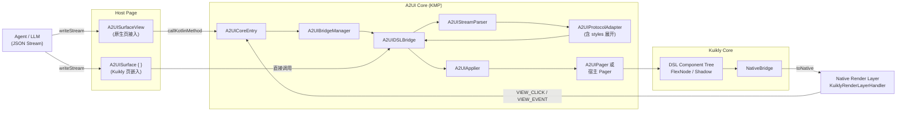
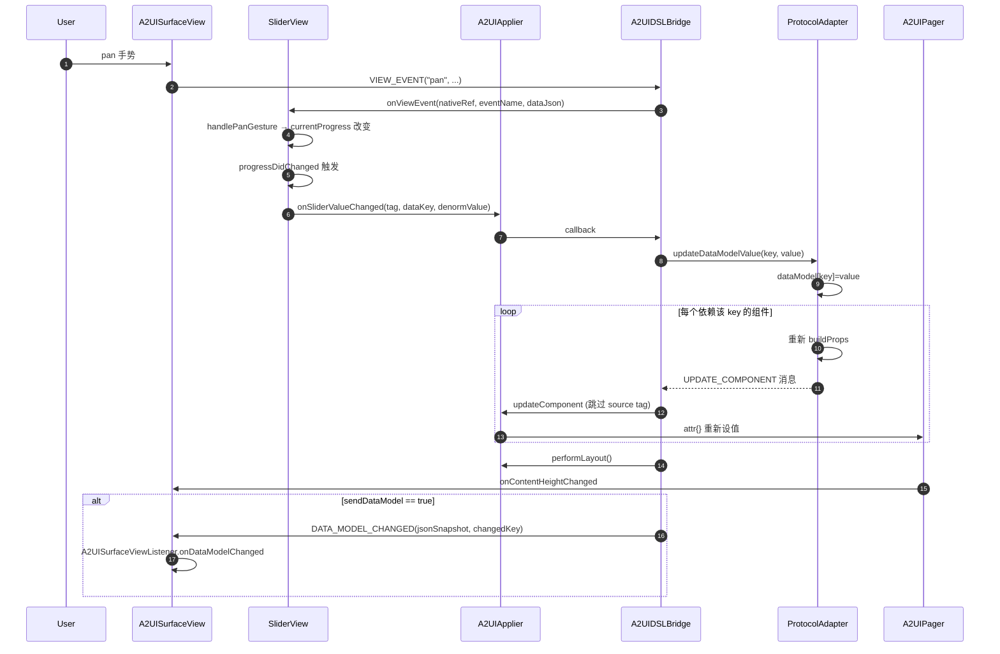
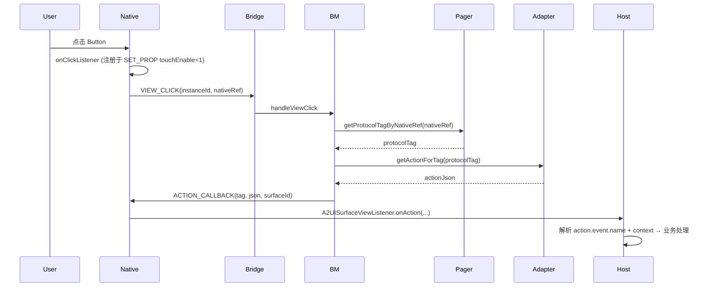

## A2UI on Kuikly：原理 / 实现架构 / 关键流程 / 逻辑细节

> 版本：基于 [A2UI v0.9 官方规范](https://a2ui.org/) + Kuikly `styles` 扩展，以及本仓库 `a2ui/` 模块当前实现整理
> 作用范围：[a2ui 模块根 README](../README.md) 描述的全部跨平台子模块（`a2ui/`、`a2ui-render-android/`、`a2ui-render-ios/`、`a2ui-render-ohos/` 及各 `androidAppFor*` / `iosAppFor*` / `ohosAppFor*` 示例工程）

---

### 1. 背景与定位

#### 1.1 A2UI 协议是什么

A2UI（Agent to UI）是 Google 主导的"AI 生成 UI"协议，专门为 LLM/Agent **流式生成可更新原生 UI** 设计。其核心理念：

1. **结构与数据分离**：UI 描述（`components`）与数据（`dataModel`）独立下发，组件通过 JSON Pointer 路径绑定数据。
2. **流式 / 增量渲染**：服务端以 JSONL 流方式持续下发消息，客户端边解析边构造 / 增量更新 UI。
3. **Catalog 可换**：协议封套（envelope）与组件目录（catalog）解耦。

v0.9 相对 v0.8 是一次"Prompt-First"重构：
- 顶层四种消息：`createSurface` / `updateComponents` / `updateDataModel` / `deleteSurface`
- 组件使用 `"component": "Text"` 这种平坦 discriminator
- 数据绑定统一为 `{"path": "/xxx"}`，函数调用统一为 `{"call": "...", "args": {...}}`
- 引入 `formatString`、`formatDate`、`pluralize`、`required`、`regex`、`email` 等 14 个预注册函数
- `ChildList` 模板渲染（`children: { path, componentId }`）
- 新增 `sendDataModel` 双向同步、`checks` 校验框架

协议规范详情见 [a2ui.org](https://a2ui.org/)。

#### 1.2 Kuikly A2UI 的扩展：`styles` 字段

Kuikly A2UI 采用的协议 catalog 位于 [`catalogs/kuikly_a2ui_catalog.json`](../catalogs/kuikly_a2ui_catalog.json)。它以 `allOf` 方式复用 A2UI v0.9 官方 catalog 中每个组件的定义，然后追加**可选**的 `styles` 属性包：

- **不写 `styles` 时**，协议仍是纯 v0.9，多端行为一致，纯官方 JSON 可以在 Kuikly A2UI 里直接运行；
- **写了 `styles` 时**，服务端可精细定制组件的原生表现层（渐变、阴影、变换、字体装饰 …）。

`styles` 分两组：

| Schema 片段 | 适用组件 | 覆盖字段 |
|-------------|---------|---------|
| `KuiklyCommonStyles` | 17 个组件（除 `Text`） | 尺寸/Flex/Margin/Padding/背景/边框/透明度/阴影/变换/绝对定位 |
| `KuiklyTextStyles` | 仅 `Text` | 在 `KuiklyCommonStyles` 之上追加字体/文本装饰/textShadow 等 13 个文本专属字段 |

> 与 A2UI 协议层字段（`id` / `action` / `accessibility` / `touchEnable`）语义重叠的字段被有意排除在 `styles` 之外，避免歧义。

`styles` 的展开由 `A2UIComponentMapper.expandStyles(...)` 完成，把每个 `styles` 里的键映射为若干条 Kuikly 原生 prop 后并回主 props map（值本身仍支持 `{"path": ...}` / `{"call": ...}` 动态语义）。完整字段清单见 [README §协议扩展](../README.md#协议扩展styles-字段)。

#### 1.3 两类组件

一个 A2UI Surface 里可以同时使用两类组件：

| 组件体系 | 用途 | 例子 | 走哪条适配路径 |
|---|---|---|---|
| **A2UI 协议标准组件（含 `styles` 扩展）** | AI 生成、跨平台标准协议 | `Text` / `Image` / `Button` / `Card` / `Column` / `Row` / `Tabs` / … | [`A2UIComponentMapper`](../a2ui/src/commonMain/kotlin/com/tencent/kuikly/a2ui/adapter/A2UIComponentMapper.kt) |
| **业务自定义组件（Custom View）** | WebView / 地图 / 图表等平台特有能力 | `A2UIWeb` / `A2UIChart` / `A2UIMap` | [`A2UICustomViewRegistry`](../a2ui/src/commonMain/kotlin/com/tencent/kuikly/a2ui/dsl/A2UICustomViewRegistry.kt) + [`A2UICustomComponentView`](../a2ui/src/commonMain/kotlin/com/tencent/kuikly/a2ui/views/A2UICustomComponentView.kt) |

> **历史遗留说明**：`KuiklyComponentMapper.isKuiklyComponent(...)` 走"KR 前缀组件直通"的旧分支在代码中仍存在（`buildKuiklyProps` 路径），但对外不再作为一等对外扩展方式宣传——扩展新组件请统一走**自定义组件**通道（`A2UICustomViewRegistry` + 平台 View 注册），详见 [自定义组件指南](./A2UI_CUSTOM_COMPONENT_GUIDE.md)。

#### 1.4 KuiklyUI 提供了什么

[KuiklyUI](https://github.com/Tencent-TDS/KuiklyUI) 是腾讯开源的 KMP 跨端 UI 框架，特点：
- Kotlin DSL 描述声明式 UI（`attr {}` / `event {}` / `addChild()`）
- 内置 FlexBox 布局引擎（`FlexNode`）
- 平台原生渲染层（Android `KRView` / iOS C++ / HarmonyOS C++）
- `Pager` 生命周期、`PagerManager` 实例管理、`NativeBridge` 标准桥接

KuiklyUI-A2UI 工程的目标：**把 A2UI v0.9 JSON 流"翻译"成 Kuikly DSL 组件树操作**，从而在 Android / iOS / HarmonyOS 上获得统一的原生渲染能力。

#### 1.5 三种页面接入模式

Kuikly A2UI 目前支持三种接入方式：

| 接入模式 | 宿主形态 | 关键 API | 详细文档 |
|---------|---------|---------|---------|
| **Native 页面接入** | 原生 `Activity` / `UIViewController` / ArkTS `@Entry` | `A2UISurfaceView`（平台 View） | [A2UI_INTEGRATION_NATIVE_PAGE.md](./A2UI_INTEGRATION_NATIVE_PAGE.md) |
| **Kuikly 页面接入** | Kuikly `Pager`（`@Page` + DSL）| `A2UISurface { }`（DSL 组件） | [A2UI_INTEGRATION_KUIKLY_PAGE.md](./A2UI_INTEGRATION_KUIKLY_PAGE.md) |
| **同一 App 同时接入两种页面** | 混合原生页 + Kuikly 页 | 上述两者共存 | [A2UI_INTEGRATION_BOTH_PAGES.md](./A2UI_INTEGRATION_BOTH_PAGES.md) |

Kuikly 页接入模式下，`A2UISurface { }` DSL 组件会构造一个 `A2UISurfaceDSLView`，直接把 A2UI 子树嵌入宿主 Pager 的 Flex 布局树中，宿主 Pager 与 A2UI 共享同一颗 FlexNode，不再新建独立 Pager。核心实现位于 [`dsl/embed/A2UISurface.kt`](../a2ui/src/commonMain/kotlin/com/tencent/kuikly/a2ui/dsl/embed/A2UISurface.kt) 与 [`dsl/embed/A2UISurfaceDSLView.kt`](../a2ui/src/commonMain/kotlin/com/tencent/kuikly/a2ui/dsl/embed/A2UISurfaceDSLView.kt)。

---

### 2. 实现总览

KuiklyUI-A2UI 工程在仓库中的物理布局：

```
a2ui/
├── a2ui/                    # KMP 跨平台核心（纯 Kotlin）
│   └── src/commonMain/kotlin/com/tencent/kuikly/a2ui/
│       ├── parser/          # JSON 流式解析（A2UIStreamParser + SimpleJsonParser）
│       ├── protocol/        # 内部消息模型（A2UIMessage / A2UIMessageType）
│       ├── adapter/         # v0.9 协议适配（含 styles 展开、Icon 注册表）
│       ├── dsl/             # Kuikly DSL 桥接（Pager / Applier / Bridge）
│       │   ├── A2UIPager.kt / A2UIApplier.kt / A2UIDSLBridge.kt
│       │   ├── A2UICustomViewRegistry.kt          # 业务自定义组件注册表
│       │   └── embed/
│       │       ├── A2UISurface.kt                 # DSL 组件（嵌入 Kuikly Pager）
│       │       └── A2UISurfaceDSLView.kt          # DSL 组件的运行时 View
│       ├── bridge/          # Native↔Kotlin 桥接定义
│       ├── function/        # 自定义函数（A2UICustomFunctionRegistry）
│       ├── views/           # A2UI 专用 VirtualView（DateTimeInputView / A2UICustomComponentView）
│       └── markdown/        # 内建 Markdown Parser
├── a2ui-render-android/     # Android 平台壳（A2UISurfaceView.kt）
├── a2ui-render-ios/         # iOS 平台壳（A2UISurfaceView.swift + A2UIRenderHelper.mm）
├── a2ui-render-ohos/        # HarmonyOS 平台壳（A2UISurfaceView.ets + ArkTS Manager）
├── catalogs/                # 协议 catalog
├── demo/                    # 业务 KMP 示例模块（@Page 页面样例）
├── androidAppForNativePage / iosAppForNativePage / ohosAppForNativePage      # Native 页接入示例
├── androidAppForKuiklyPage / iosAppForKuiklyPage / ohosAppForKuiklyPage      # Kuikly 页接入示例
├── androidAppForBothPages  / iosAppForBothPages  / ohosAppForBothPages       # 双接入示例
└── androidAppForTest       / iosAppForTest       / ohosAppForTest            # 协议 & 功能测试 App
```

#### 2.1 整体数据流



#### 2.2 架构核心特征

| 设计点 | 决策 | 落点 |
|---|---|---|
| 协议 → 组件 | 经 `A2UIProtocolAdapter` 把 v0.9 平坦协议（含 `styles` 扩展）转换成内部 `A2UIMessage` 序列 | [`A2UIProtocolAdapter.kt`](../a2ui/src/commonMain/kotlin/com/tencent/kuikly/a2ui/adapter/A2UIProtocolAdapter.kt) |
| `styles` 展开 | 通过 `A2UIComponentMapper.expandStyles(...)` 把可选 `styles` 键映射为 Kuikly 原生 prop | [`A2UIComponentMapper.kt`](../a2ui/src/commonMain/kotlin/com/tencent/kuikly/a2ui/adapter/A2UIComponentMapper.kt) |
| 组件 → 视图 | `A2UIApplier` 把消息直接翻译为 Kuikly DSL `addChild` / `attr {}` / `removeChild` | [`A2UIApplier.kt`](../a2ui/src/commonMain/kotlin/com/tencent/kuikly/a2ui/dsl/A2UIApplier.kt) |
| 布局 | 完全复用 Kuikly FlexNode 引擎，A2UI 不做手动布局 | `A2UIPager` 走内容驱动 |
| 文本测量 | 复用 RichTextView 内置 Shadow，无需手动 MeasureFunction | `KuiklyComponentMapper.SHADOW_COMPONENTS` |
| 双向绑定 | TextField / CheckBox / Slider / ChoicePicker / DateTimeInput 走 `__xxxBindingPath` | `Applier.onXxxValueChanged` 回调链 |
| 容器自适应高度 | WRAP_CONTENT：root FlexNode 算完高度后回报给 Native | `pageViewHeight = 10000` 哨兵 + `onContentHeightChanged` |
| Kuikly 页嵌入 | 用 `A2UISurface { }` DSL 组件把 A2UI 子树挂到宿主 Pager 的 Flex 树 | [`embed/A2UISurface.kt`](../a2ui/src/commonMain/kotlin/com/tencent/kuikly/a2ui/dsl/embed/A2UISurface.kt) / [`A2UISurfaceDSLView.kt`](../a2ui/src/commonMain/kotlin/com/tencent/kuikly/a2ui/dsl/embed/A2UISurfaceDSLView.kt) |
| 三大对外扩展 | 自定义函数 / 自定义组件 / 自定义 Icon 图片均为一等对外能力 | `A2UICustomFunctionRegistry` / `A2UICustomViewRegistry` / `A2UIIconRegistry` |

---

### 3. 演进里程碑

按主题归类的实现主线（不再枚举全部逐条提交）：

| 阶段 | 主要工作 |
|---|---|
| ① 框架初始化 | KuiklyUI-A2UI 工程基础骨架、Message 内部模型、流式解析器 |
| ② 切换到 Kuikly DSL 路径 | 从旧的"消息→FlexNode→KRRender"重构为 `A2UIDSLBridge → A2UIApplier → Kuikly DSL Tree` |
| ③ 三端平台壳 | Android `A2UISurfaceView.kt`、iOS `A2UISurfaceView.swift` + `A2UIRenderHelper.mm`、HarmonyOS `A2UISurfaceView.ets` |
| ④ v0.9 协议适配主线 | 实现 v0.9 basic catalog；36 个官方示例接入；ChildList 模板；14 个内置函数 |
| ⑤ 组件与交互完备 | Tabs / ChoicePicker / DateTimeInput / Slider / CheckBox / TextField / Checks 校验 / Action 机制 |
| ⑥ 双向绑定与数据同步 | `A2UIValue` 类型安全值、`sendDataModel` 双向同步、模板 scope 相对路径、依赖追踪 |
| ⑦ Kuikly `styles` 扩展 | catalog 增加 `KuiklyCommonStyles` / `KuiklyTextStyles`；`A2UIComponentMapper.expandStyles(...)` 展开 |
| ⑧ Kuikly 页嵌入 | `A2UISurface { }` DSL 组件 + `A2UISurfaceDSLView`，与宿主 Pager 共享同一颗 Flex 树 |
| ⑨ HarmonyOS 平台壳 | `a2ui-render-ohos` 模块 + ArkTS `A2UINativeManager` + Option-A 双 libshared.so 构建脚本 |
| ⑩ 三大对外扩展 | `A2UICustomFunctionRegistry` / `A2UICustomViewRegistry` / `A2UIIconRegistry` 一等 API |
| ⑪ Action 协议收敛 | 移除自定义 `showAlert`；`action.functionCall` 仅保留 `openUrl` + 用户 VOID 自定义函数（非保留名 warn） |
| ⑫ 12 个示例 App | `androidAppFor* / iosAppFor* / ohosAppFor*` × 4 种接入形态，Test App 覆盖 36 个 v0.9 官方示例 |

---

### 4. 协议规范要点速查（v0.9 + Kuikly `styles`）

下面是与实现强相关的协议要点（完整内容见 [a2ui.org](https://a2ui.org/)；Kuikly 扩展见 [`catalogs/kuikly_a2ui_catalog.json`](../catalogs/kuikly_a2ui_catalog.json)）：

#### 4.1 四种 Server→Client 消息

| 消息 | 字段 | 语义 |
|---|---|---|
| `createSurface` | `surfaceId`、`catalogId`、`theme.primaryColor`、`sendDataModel` | 创建表面，固定 catalog；root 节点必须有 `id: "root"` |
| `updateComponents` | `surfaceId`、`components: [...]` | 平坦组件列表 + adjacency-list 树关系（`children`/`child`） |
| `updateDataModel` | `surfaceId`、`path?`、`value?` | upsert：path 缺省替换整个 dataModel；value 缺省删除 key |
| `deleteSurface` | `surfaceId` | 销毁 |

#### 4.2 数据模型（Dynamic*）

任何属性都可以是：
- 字面量（string / number / bool / list）
- `{"path": "/abs/path"}` JSON Pointer 绝对路径
- `{"path": "relative/path"}` 相对路径（仅 ChildList 模板内有效）
- `{"call": "fnName", "args": {...}}` 函数调用

输入组件（TextField/CheckBox/Slider/ChoicePicker/DateTimeInput）建立**双向绑定**：用户操作即时改 dataModel，所有依赖该路径的组件自动重渲。

#### 4.3 ChildList 模板

```json
{ "id": "list", "children": { "path": "/items", "componentId": "row-tpl" } }
```
对每个 `/items[i]` 实例化模板树，模板内的相对路径基于该子项 scope 解析。

#### 4.4 函数

basic catalog 内置 14 个函数：`required` / `regex` / `length` / `numeric` / `email` / `formatString` / `formatNumber` / `formatCurrency` / `formatDate` / `pluralize` / `openUrl` / `and` / `or` / `not`。

#### 4.5 Checks

```json
"checks": [{ "call": "required", "args": {"value": {"path": "/email"}}, "message": "..." }]
```
- 输入组件失败：渲染错误文本、红边框
- Button 失败：自动 disabled

#### 4.6 Action

```json
"action": { "event": { "name": "submit", "context": {...} } }
"action": { "functionCall": { "call": "openUrl", "args": {"url": "..."} } }
```

- `action.event`：宿主 App 通过 `onAction(...)` 收到 event `name` + `context`，业务侧处理（弹 Toast、跳页、埋点 …）。
- `action.functionCall`：**仅**允许 A2UI v0.9 保留的 `openUrl` 或宿主注册的**用户自定义 VOID 函数**（详见 [自定义函数指南](./A2UI_CUSTOM_FUNCTION_GUIDE.md)）。JSON 中若写了非保留、非注册的函数名，`A2UIBridgeManager.tryHandleFunctionCall(...)` 会打印 warn 日志并静默丢弃，避免误用。
- 早期版本曾内建 `showAlert` 便利函数，现已移除；如需 alert / toast，请通过 `action.event` 由业务侧决定 UI。

#### 4.7 Kuikly `styles` 扩展

每个 A2UI 标准组件都可以在 v0.9 语义字段之外，追加一个可选的 `styles` 对象——里面的键属于 `KuiklyCommonStyles`（17 组件）或 `KuiklyTextStyles`（仅 `Text`）：

```json
{
  "id": "card", "component": "Card", "child": "title",
  "styles": {
    "padding": 16,
    "borderRadius": 12,
    "boxShadow": { "offsetX": 0, "offsetY": 4, "radius": 12, "color": "#22000000" }
  }
}
```

`styles` 里的**每个值**都仍然支持 `{"path": "/theme/color"}` 数据绑定或 `{"call": "xxx", "args": {...}}` 函数调用，与协议层字段等价。展开由 `A2UIComponentMapper.expandStyles(...)` 完成，实现细节见 §5.3.5。

---

### 5. 实现架构详解

下文按照"模块 → 文件 → 关键逻辑"的方式展开。

#### 5.1 协议层：Message 内部模型

[`A2UIMessageType.kt`](../a2ui/src/commonMain/kotlin/com/tencent/kuikly/a2ui/protocol/A2UIMessageType.kt) 定义内部消息枚举：`CREATE_SURFACE / CREATE_COMPONENT / UPDATE_COMPONENT / REMOVE_COMPONENT / UPDATE_DATA / BATCH_UPDATE / SET_LAYOUT / STREAM_END / ACTION / EVENT / ...`

[`A2UIMessage.kt`](../a2ui/src/commonMain/kotlin/com/tencent/kuikly/a2ui/protocol/A2UIMessage.kt) 是统一数据载体（`type` / `surfaceId` / `tag` / `viewName` / `parentTag` / `index` / `props` / `data` / `messages` / `config`）。

> **关键设计**：`A2UIProtocolAdapter` 把 v0.9 外部协议（字符串 id + 嵌套结构）转换为这套内部格式（**整型 tag + 显式 parentTag/index**），后续 `Applier` 完全只面向内部格式工作。这使得 Applier 可以与协议版本解耦。

#### 5.2 解析层：流式 JSON 增量解析

[`A2UIStreamParser.kt`](../a2ui/src/commonMain/kotlin/com/tencent/kuikly/a2ui/parser/A2UIStreamParser.kt) 实现：

- 字符级状态机：跟踪 `braceDepth`、`inString`、`escaped`、`messageStartIndex`，支持 chunk 分片喂入
- 大括号深度归零时切出一个完整 JSON 对象，调用 `SimpleJsonParser.parse(...)` 解析为 `Map<String, Any?>`
- **格式自适应**：第一条消息若含 `version` / `createSurface` / `updateComponents` / `updateDataModel`，判定为标准 v0.9 → 经 `A2UIProtocolAdapter.convertMessage()` 转内部格式；否则视为 legacy 内部格式
- `feed(chunk)` 增量喂数据；`finish()` 触发 `onStreamEnd` 但**不重置** `protocolAdapter`（保留 surface 生命周期内的 `tagToAction / idToTag`），仅 `reset()` 全量重置

> 这种"父级解析器 + 协议适配器"分工，使得后续若要支持 v0.9.1 / v1.0，只需新增 Adapter 实现，不动解析器与 Applier。

#### 5.3 适配层：A2UIProtocolAdapter（核心）

[`A2UIProtocolAdapter.kt`](../a2ui/src/commonMain/kotlin/com/tencent/kuikly/a2ui/adapter/A2UIProtocolAdapter.kt)（148KB / 3628 行，单类）是整个 a2ui 模块中**最复杂也最重要**的一块。它维护下列状态：

| 状态 Map | 用途 |
|---|---|
| `idToTag` | 协议 string id → 内部 int tag |
| `tagToComponentName` | tag → v0.9 组件类型（用于 buttonVariant 等回查） |
| `idToChildren` | id → 当前子节点 id 列表（增量 diff 用） |
| `idToOriginalDef` | id → 原始组件 JSON 定义（dataModel 更新时重新评估属性） |
| `tagToAction` | tag → action JSON 字符串（点击时透传给 host） |
| `dataKeyToFuncDependents` / `dataKeyToPathDependents` / `dataKeyToChecksDependents` | 数据 key → 依赖该 key 的组件 id（精准重渲依据） |
| `checksRegistry` / `idToCheckErrorTag` / `idToCheckWrapperTag` | 校验规则 + 错误文案 view tag + 错误包裹 Column tag |
| `choicePickerChipTags` / `choicePickerChipValues` | ChoicePicker 展开后的 chip tag 与 value（重渲选中态用） |
| `tabsDefinitions` / `tabsSelectedIndex` / `tabsHeaderTags` / `tabsContentWrapperTags` | Tabs 展开为 Row(headers)+多个 contentWrapper 的 metadata |
| `childListBindings` | 模板绑定：parentId → `(dataPath, templateId, generatedInstanceIds)` |
| `instanceScopePath` | 模板实例 id → 该实例对应的 scope 路径（如 `/events/0`） |
| `dataModel` | 客户端数据模型副本，绝对路径访问 |
| `primaryColor` / `sendDataModel` | 主题色与同步开关（来自 `createSurface`） |

下面分模块阐述其逻辑。

##### 5.3.1 `handleCreateSurface`

读取 `surfaceId` / `theme.primaryColor` / `sendDataModel`，记 `currentSurfaceId`，发出 `CREATE_SURFACE` 内部消息。`primaryColor` 后续用于 `Button variant=primary` 的背景色和 ChoicePicker 选中态颜色。

##### 5.3.2 `handleUpdateComponents`（增量树构造）

完整流程是 5 趟扫描：

1. **Pass 1：分配 tag** —— 遍历 components，新 id 分配自增 tag、记入 `newIds`
2. **Pass 2：建父子关系** —— 同时处理三种引用：
   - `children: ["a","b","c"]` 静态数组
   - `children: { path, componentId }` ChildList 模板（注册 `childListBindings`，**不进 childToParent**，而是注册 `__childlist__$id` 依赖标记到 `dataKeyToPathDependents`）
   - `child: "x"` 单子（Card / Button）
   - `tabs: [...]` Tabs 子结构（写入 `tabsDefinitions`）
   - 同步缓存 `componentVariantCache[id] = variant`
3. **Pass 3：拓扑排序** —— 用经典 DFS 保证父先于子：
   ```kotlin
   fun visit(id: String) {
       if (id in visited || id !in idToComp) return
       visited.add(id)
       childToParent[id]?.let { if (it in idToComp) visit(it) }
       sortedIds.add(id)
   }
   ```
4. **Pass 4：屏蔽模板树** —— 对每个 `childListBindings`，把 templateId 及其后代 id 全部加入 `templateIds`，避免它们作为普通组件创建（仅在数据到来时实例化）
5. **Pass 5：按拓扑顺序生成消息**——这是真正的核心：
   - 普通组件：`buildKuiklyProps` (KR 前缀直通) 或 `buildProps`(v0.9 语义映射) → 一条 `CREATE_COMPONENT`
   - **TextField with checks**：自动扩展为 `Column(wrapper) → [TextField, Text(error)]`，error 文本初始隐藏（`height=0, opacity=0`），分配额外两个 tag
   - **ChoicePicker**：扩展为 `Row → chip[…]`，每个 chip 是 `KRView + KRRichTextView`，chip 上注入 `__choicePickerParentId` / `__choiceOptionValue` / `__choicePickerVariant`，点击事件由 `A2UIApplier` 注册一次
   - **Tabs**：扩展为 `Column → [HeaderRow → headers..., ContentWrapper0, ContentWrapper1, ...]`；非选中 wrapper `height=0`，选中 wrapper `flex=1`；headers 注入 `__tabsParentId` / `__tabIndex`
   - **已存在组件**：发 `UPDATE_COMPONENT` + 老 children 中已删除的发 `REMOVE_COMPONENT`

##### 5.3.3 `handleUpdateDataModel`（数据驱动重渲）

```
upsert dataModel
 → expandChildListBindings()      // 重新展开模板列表
 → for compId in 受影响组件:
       根据 originalDef 重新 buildProps + 发 UPDATE_COMPONENT
       特殊处理：ChoicePicker 重渲所有 chip 的选中态、Checks 重新评估
```

`expandChildListBindings` 的算法：
1. 拿到 `dataPath` 上的 List 数据
2. 删除上一轮 `generatedInstanceIds` 对应的所有 view（`REMOVE_COMPONENT`）
3. 对每个 array item：以 `instanceId = "${templateId}__${index}"` 命名，递归调用 `instantiateTemplate` / `instantiateNestedChild` 创建模板树副本
4. 模板树内构造 props 时调用 `buildPropsWithScope`，**相对路径通过 `resolveRelativePath(itemData)` 解析**，绝对路径仍走 `resolveNestedDataPath(dataModel)`

##### 5.3.4 `buildProps` 与"语义默认值"

不同于"哑直通"，buildProps 为每种 v0.9 组件**注入实现指南要求的默认布局/样式**（详见 [basic_catalog_implementation_guide.md](https://a2ui.org/)）：

| 组件 | 默认值（节选） |
|---|---|
| `Row` | `flexDirection=row`、`alignSelf=stretch` |
| `Column` | `flexDirection=column`、`alignSelf=stretch`；若父是 Row 且无 weight，则 `flex=1` |
| `Card` | `borderRadius=12`、`borderWidth=1 #E0E0E0`、`padding=16`、`margin=8`（root 时 margin=0） |
| `Divider` | 1dp 线 + 8dp 上下 margin |
| `Button` | `padding=10/16` + 三 variant：primary 用 `primaryColor`、borderless 透明、default 灰底 |
| `Image` | 7 种 variant（icon/avatar/smallFeature/mediumFeature/largeFeature/header/default）：根据是否在 Row 内决定 fixed-size 或 stretch |
| `Icon` | 24dp 宽 + fontSize=20，Row/Button 内 margin=0 + marginRight=4 |
| `Text` | margin=8；如父是 primary Button，强制 `color=#FFFFFF` 且 margin=0 |
| `TextField` | 44dp 高、1dp solid #CCCCCC 边框；从 `value.path` 抽取 `__textFieldBindingPath` |
| `CheckBox` | 24x24 固定（CheckBoxView.didInit 要求） |
| `Slider` | `alignSelf=stretch`、height=40；抽取 `__sliderBindingPath` 与 `min/max` |
| `ChoicePicker` | `flexDirection=row, flexWrap=wrap`；`__choicePickerOptions/Variant/DisplayStyle/BindingPath` |
| `DateTimeInput` | `alignSelf=stretch`、margin=8；透传 `enableDate/enableTime/label` |
| `Tabs` | `flexDirection=column, alignSelf=stretch` |

然后遍历 `compMap` 的剩余字段，调用 `A2UIComponentMapper.mapProp(componentType, key, value)` 做语义映射（详见 5.3.5），最后处理 `action` / `checks` / `weight`。

##### 5.3.5 A2UIComponentMapper：v0.9 语义到 Kuikly 的转换

[`A2UIComponentMapper.kt`](../a2ui/src/commonMain/kotlin/com/tencent/kuikly/a2ui/adapter/A2UIComponentMapper.kt) 集中了**协议层名词到 Kuikly 渲染层名词的映射表**：

```
Text       → KRRichTextView
Image      → KRImageView
Icon       → KRRichTextView (用 emoji/unicode 渲染)
Row/Column → KRView (flexDirection 不同)
List       → KRScrollView
Card       → KRView
Button     → KRView
TextField  → KRTextFieldView
CheckBox   → KRCheckBoxView
Slider     → KRSliderView
ChoicePicker → KRView (展开为 chip)
Tabs       → KRView (展开为 header+wrapper)
Modal      → KRView (placeholder)
DateTimeInput → KRDateTimeInputView (a2ui 自有 VirtualView)
Video / AudioPlayer → KRView (placeholder)
```

属性翻译（节选）：

| v0.9 属性 | Kuikly 属性 | 备注 |
|---|---|---|
| `text` (Text) | `text` | 经 `resolveTextValue()` 包装为 `A2UIValue.{Literal,PathBinding,FunctionCall}` |
| `variant` (Text) | 展开成 `fontSize`+`fontWeight`+`color` | h1=40 / h2=32 / ... / caption=13#666 / body=16#1A1A1A |
| `url` (Image) | `src` | |
| `fit` (Image) | `resizeMode` | contain/cover/stretch/center |
| `name` (Icon) | `text` | 60+ 个 emoji 映射；data binding 时延迟到 `resolveIconNameToChar` |
| `justify` (Row/Column) | `justifyContent` | start→flex-start, spaceBetween→space-between, ... |
| `align` (Row/Column) | `alignItems` | start→flex-start, end→flex-end, stretch |
| `label`/`value` (TextField) | `placeholder`/`text` | |
| `variant` (TextField) | obscured→keyboardTypePassword / email / number | |
| `value` (CheckBox) | `checked` | 抽 `__checkBoxBindingPath` |
| `value`/`min`/`max` (Slider) | 直接传 + 在 Applier 里 `[min,max]→[0,1]` 归一化 | |

KR 前缀的 Kuikly 组件在代码中仍保留一条直通路径 [`KuiklyComponentMapper.kt`](../a2ui/src/commonMain/kotlin/com/tencent/kuikly/a2ui/adapter/KuiklyComponentMapper.kt)（组件名照原样、属性照原样、不注入语义默认值）——这是早期 A2UI 允许 JSON 里直接写 `{"component": "KRView", ...}` 时的实现痕迹。**新版本不再作为一等对外扩展方式宣传**，业务扩展请统一走"自定义组件"通道（`A2UICustomViewRegistry` + [`A2UICustomComponentView`](../a2ui/src/commonMain/kotlin/com/tencent/kuikly/a2ui/views/A2UICustomComponentView.kt)），详见 [自定义组件指南](./A2UI_CUSTOM_COMPONENT_GUIDE.md)。

##### 5.3.6 `styles` 扩展的展开：`A2UIComponentMapper.expandStyles`

在 `buildProps` 处理完 v0.9 语义字段后，会读取组件 JSON 中可选的 `styles` map 交给 `A2UIComponentMapper.expandStyles(componentName, styles)`：

- 按 `COMMON_STYLE_KEYS` / `TEXT_STYLE_KEYS` 白名单过滤——未知键静默丢弃，避免协议演进时旧客户端崩溃。
- **不做 literal 计算**：`styles` 里的值原样返还（可能是 `Any`、`{"path":...}`、`{"call":...}`），后续由 Applier 的 `resolveValue`/`resolveValueWithScope` 统一评估，保证与协议层字段等价的 data binding / functionCall 能力。
- 对于 `borderColor`+`borderWidth`+`borderStyle` 这种"组合类" prop，`expandStyles` 会依据顺序合并为单一 Kuikly `border`，确保 `attr {}` 内一次设置生效。
- `Text` 组件同时接受 `KuiklyCommonStyles` + `KuiklyTextStyles` 两组白名单；其他组件只接受 `KuiklyCommonStyles`。

展开完成后的 `(key, value)` 列表直接 `putAll` 到主 props map 上，与协议层字段（`text` / `align` / `justify` / …）共用同一份 `attr {}` 通道，实现"协议 + 表现层"透明混合。

##### 5.3.7 类型安全的 Dynamic 值：A2UIValue

[`A2UIValue.kt`](../a2ui/src/commonMain/kotlin/com/tencent/kuikly/a2ui/adapter/A2UIValue.kt) 定义 sealed class：

```kotlin
sealed class A2UIValue {
    data class Literal(val value: Any) : A2UIValue()
    data class PathBinding(val path: String, val isAbsolute: Boolean) : A2UIValue()
    data class FunctionCall(val definition: Map<*, *>) : A2UIValue()
}
```

设计动机：早期实现用 `String` 表示 path（"以 / 开头判定为路径"），但当 LLM 生成 `"/images/logo.png"` 这种字面 URL 时会被误判为路径。引入 sealed class 后，整个值传递链路保留语义，避免 `startsWith("/")` heuristic。

`resolveValue` 在主路径走根 dataModel；`resolveValueWithScope` 在 ChildList 模板内根据 `isAbsolute` 决定查根还是查 itemData。

##### 5.3.8 函数评估器（formatString / formatDate / formatNumber / formatCurrency / pluralize）

`evaluateFunctionCall` 是分发器，按 `call` 名调用：

- **`formatDate(value, format)`**：自实现 ISO 8601 解析 → 按 pattern 输出（pattern 支持 `yyyy/yy/MM/MMM/dd/d/HH/h/mm/E`），KMP 自实现，跨平台一致
- **`formatNumber(value, decimals?, useGrouping?)`**：手写 `addThousandsSeparator`
- **`formatCurrency(value, currency, decimals?)`**：包 `formatNumber` + 货币符号
- **`pluralize(count, one, other, zero?, ...)`**：CLDR 简化版
- **`formatString(value)`**：最复杂——递归扫描 `${...}` 表达式，区分"路径"`${/foo/bar}`、"内联函数调用"`${formatDate(value:..., format:...)}`、嵌套函数 `${upper(${now()})}`，逐层解析

依赖追踪：每次评估时把"参数中的 path"通过 `extractDataPaths` 抽出，注册到 `dataKeyToFuncDependents`；后续 `updateDataModel` 即可定向重渲依赖该 key 的组件。

##### 5.3.9 Checks 与 disabled

`registerChecks(id, checks)` 把每条 check 的 path 注册到 `dataKeyToChecksDependents`；`evaluateChecksForComponent(id)` 对每条 check 执行（`required`/`regex`/`length`/`numeric`/`email`/`and`/`or`/`not` 等），返回首个失败的 message 或 null。在 buildProps 阶段：
- TextField/CheckBox：写入 `__checkError`（用于 wrapper 内的 error Text）+ 红色 border
- Button：失败则 `__disabled=true` → Applier 设 `opacity=0.4` + `touchEnable=false`

#### 5.4 DSL 桥接层

##### 5.4.1 A2UIPager

[`A2UIPager.kt`](../a2ui/src/commonMain/kotlin/com/tencent/kuikly/a2ui/dsl/A2UIPager.kt) 继承 Kuikly `Pager`：

- `tagToView` / `nativeRefToProtocolTag` 双向映射，使得 Native 上报的 `nativeRef` 能反查回 A2UI 协议 tag（`getProtocolTagByNativeRef`），是点击事件分发的关键
- `body()` 返回一个空 attr 的 Column 容器
- `setSurfaceWidth(w)` / `setSurfaceSize(w, h)`：宽度走 `attr.width`，高度若 ≥10000 或 ≤0 则把 `flexNode.styleHeight = NaN`，让 FlexBox 引擎按内容自动算
- `performLayoutAndReportHeight()`：调 `onLayoutView()` 触发布局 → 读 `flexNode.layoutFrame.height` → 通过 `onContentHeightChanged` 回报 Native

##### 5.4.2 A2UIApplier

[`A2UIApplier.kt`](../a2ui/src/commonMain/kotlin/com/tencent/kuikly/a2ui/dsl/A2UIApplier.kt) 是**消息→DSL 树**的执行者：

- `createDSLView(viewName)` 工厂：把 `KRView/KRRichTextView/KRImageView/KRTextFieldView/KRSliderView/KRCheckBoxView/KRDateTimeInputView` 映射到 `DivView/RichTextView/ImageView/InputView/SliderView/CheckBoxView/DateTimeInputView`
- `createComponent(tag, viewName, parentTag, index, props)` 三段式：
  1. **设置 `BridgeManager.currentPageId = pager.pagerId`**（attr{} 内 ReactiveObserver 必需）
  2. 按 viewName 选择策略：
     - `SliderView`：先用临时宽度 `pager.surfaceWidth * 0.8f` 让 didInit 通过 → addChild 后把 styleWidth 重设为 NaN 让 alignSelf=stretch 生效 → 在 `pagerUpdateLayoutFinish` 后用真实宽度刷新（保证 panGesture 进度计算正确）
     - `CheckBoxView` / `DateTimeInputView`：props 必须在 init lambda 中传入（didInit 依赖）
     - 其他 view：先 addChild 空 init → 再 applyProps（让 isRenderView 检查通过）→ 最后 `insertDomSubView`
- `applyCommonProps`：完整覆盖 width/height/min/max/flex/margin/padding/borderRadius/opacity/overflow/border/boxShadow/positionType/top/left/bottom/right/alignSelf/touchEnable/`__disabled`
- `ViewContainer` 额外：padding 系列、flexDirection、justifyContent、alignItems、alignContent、flexWrap
- `applyTextProps` / `applyImageProps` / `applyTextFieldProps` / `applySliderProps` / `applyCheckBoxProps` / `applyDateTimeInputProps`：每种类型独立处理，包括各自的双向绑定路径注册（`__sliderBindingPath` / `__checkBoxBindingPath` / `__textFieldBindingPath` / `__dateTimeBindingPath`），事件订阅只注册一次（用 `xxxBindingPaths` Map 判重）
- ChoicePicker chip 与 Tabs header 的点击事件在 `applyProps` 末尾按 `__choicePickerParentId` / `__tabsParentId` 标记延迟注册（用 `choiceChipRegistered` / `tabHeaderRegistered` Set 判重）

##### 5.4.3 A2UIDSLBridge

[`A2UIDSLBridge.kt`](../a2ui/src/commonMain/kotlin/com/tencent/kuikly/a2ui/dsl/A2UIDSLBridge.kt) 是连接 Parser、Adapter、Applier、Pager 的"指挥中枢"：

- `initialize(width)`：
  1. `BridgeManager.init` / `CrossPlatFeature.isIgnoreRenderViewForFlatLayer = true`（A2UI 必须关闭"扁平层"优化，因为容器要被识别为 RenderView）
  2. 注册 NativeBridge / `PagerManager.registerPageRouter("a2ui_dsl_$instanceId")` / `PagerManager.createPager(...)`
  3. 设置 `BridgeManager.currentPageId = instanceId`（**一定要在 createPager 之前**，否则 body() 中 attr{} 找不到 ReactiveObserver）
  4. 创建 `A2UIApplier` 并配齐 5 个回调：`onSliderValueChanged`、`onCheckBoxValueChanged`、`onTextFieldValueChanged`、`onShowDateTimePicker`、`onChoicePickerValueChanged`、`onTabSelected`
  5. 创建 `A2UIStreamParser` 并把 `protocolAdapter` 暴露给外部
- `writeStream(chunk)` / `finishStream()`：转发给 parser；parser 通过 listener 回调 → Bridge.handleMessage → Applier
- `handleMessage` 是消息分发器：对应到 Applier 的 `createComponent` / `updateComponent` / `removeComponent` / `performLayout`，并把 `BATCH_UPDATE` 递归展开
- 双向绑定回调链路（以 Slider 为例）：
  ```
  用户拖动 → SliderView.progressDidChanged
   → Applier.onSliderValueChanged(tag, dataKey, denormalized)
   → Bridge: protocolAdapter.updateDataModelValue(dataKey, value)
              → 返回受影响组件的 UPDATE_COMPONENT 消息列表
              → 跳过 source tag（避免反馈环），其他全部 handleMessage
              → applier.performLayout()
              → 若 sendDataModel：onDataModelChanged(snapshot, key)
  ```

#### 5.5 桥接定义

[`A2UIBridgeManager.kt`](../a2ui/src/commonMain/kotlin/com/tencent/kuikly/a2ui/bridge/A2UIBridgeManager.kt) 是 KMP 公共层入口，按 `instanceId` 维护 `nativeBridgeMap` / `dslBridgeMap` / `surfaceSizeMap`。Native→Kotlin 通过 `callKotlinMethod(methodId, ...)` 进入这里分发到：

`INIT` / `WRITE_STREAM` / `FINISH_STREAM` / `DESTROY` / `SET_SURFACE_SIZE` / `VIEW_CLICK` / `VIEW_EVENT` / `LAYOUT_VIEW` / `PICKER_RESULT` / `REGISTER_CUSTOM_FUNCTION` / `UNREGISTER_CUSTOM_FUNCTION` / `REGISTER_CUSTOM_VIEW` / `UNREGISTER_CUSTOM_VIEW` / `REGISTER_ICON` / `UNREGISTER_ICON`（详见 [`A2UIKotlinMethod`](../a2ui/src/commonMain/kotlin/com/tencent/kuikly/a2ui/bridge/A2UINativeMethod.kt)）。

其中三对 `REGISTER_* / UNREGISTER_*` 服务于三大对外扩展：**自定义函数**、**自定义组件**、**自定义 Icon 图片**——注册状态在 `A2UICustomFunctionRegistry` / `A2UICustomViewRegistry` / `A2UIIconRegistry` 中全局保存，跨所有 A2UI 实例可见。

##### `tryHandleFunctionCall` 与 Action 保留名策略

`A2UIBridgeManager.tryHandleFunctionCall(instanceId, actionJson)` 是 Action 派发前的**函数调用拦截器**：

1. 解析 `actionJson.functionCall.call` 函数名与 `args`；
2. 若命中已注册的**自定义函数**（`A2UICustomFunctionRegistry`）：走 `EXECUTE_FUNCTION_CALL`（methodId=106），根据 spec 的 sync/async + returnType 决定同步/异步；
3. 若函数名是 A2UI v0.9 唯一保留内建 `openUrl`：走 `OPEN_URL`（methodId=105），交给宿主实际打开；
4. 若既不是自定义函数、也不是 `openUrl`：打印 warn 日志（"neither a registered custom function nor a reserved A2UI v0.9 built-in"）并静默丢弃，防止 JSON 里错误的 function 名称把宿主拖入未定义行为；
5. 返回值：是否已处理，被处理的 Action 不再进入常规 `ACTION_CALLBACK` 通道。

##### HarmonyOS 平台的补丁通道

`A2UIBridgeManager.dispatchToA2UIBridgeModule(...)` 是**只在 HarmonyOS 上生效**的旁路——通过 `KuiklyCore.callModuleMethod("A2UIBridgeModule", ...)` 走 ArkTS 模块通知宿主：

- 硬门：`if (!isModuleBasedPlatform) return null`（iOS / JVM 上直接短路，零成本；Android 与 OHOS 均返回 true 并走 Module 通道）；
- 兼容性：由于历史原因，HarmonyOS 端的 C++ 渲染层不路由部分 A2UI 自有 methodId（105/106/107 等），这条旁路把关键调用同步以 Module Method 形式复制一份给 ArkTS，保证 HarmonyOS 宿主也能收到 `OPEN_URL` / `EXECUTE_FUNCTION_CALL` / `INVOKE_CUSTOM_FUNCTION`；
- 防御：包裹 `try/catch(Throwable)`，宿主尚未注册 `A2UIBridgeModule` 时打印一条日志、不影响主流程。

##### methodId 常量表（节选）

[`A2UINativeMethod.kt`](../a2ui/src/commonMain/kotlin/com/tencent/kuikly/a2ui/bridge/A2UINativeMethod.kt) 完整定义如下：

| 分类 | ID | 常量 | 作用 |
|---|---|---|---|
| Core 渲染 | 1–17 | `CREATE_VIEW` / `REMOVE_VIEW` / `INSERT_SUB_VIEW` / `SET_PROP` / `SET_FRAME` / `CALL_VIEW_METHOD` / `CALL_MODULE_METHOD` / `CREATE_SHADOW` / `REMOVE_SHADOW` / `SET_SHADOW_PROP` / `SET_SHADOW_FOR_VIEW` / `CALL_SHADOW_METHOD` / `SYNC_FLUSH_UI` / `CALL_TDF_MODULE_METHOD` / … | 与 Kuikly Core 标准 NativeMethod 对齐 |
| A2UI 自有 | 100 | `MEASURE_SHADOW_SIZE` | 同步测量 Shadow 大小 |
| A2UI 自有 | 101 | `ACTION_CALLBACK` | Action 派发到宿主 |
| A2UI 自有 | 102 | `CONTENT_HEIGHT_CHANGED` | 内容自适应高度回报 |
| A2UI 自有 | 103 | `SHOW_DATE_TIME_PICKER` | 弹原生日期/时间选择器 |
| A2UI 自有 | 104 | `DATA_MODEL_CHANGED` | `sendDataModel` 双向同步 |
| A2UI 自有 | 105 | `OPEN_URL` | 请求宿主打开 URL |
| A2UI 自有 | 106 | `EXECUTE_FUNCTION_CALL` | 客户端 functionCall 执行 |
| A2UI 自有 | 107 | `INVOKE_CUSTOM_FUNCTION` | 调用宿主注册的自定义函数（sync/async × void/string/boolean/number/array） |

对应的 Native→Kotlin 方向常量位于同文件的 [`A2UIKotlinMethod`](../a2ui/src/commonMain/kotlin/com/tencent/kuikly/a2ui/bridge/A2UINativeMethod.kt) 对象中。

##### 三端 `A2UICoreEntry`

- [`androidMain/…/A2UICoreEntry.kt`](../a2ui/src/androidMain/kotlin/com/tencent/kuikly/a2ui/bridge/A2UICoreEntry.kt) / [`iosMain/…/A2UICoreEntry.kt`](../a2ui/src/iosMain/kotlin/com/tencent/kuikly/a2ui/bridge/A2UICoreEntry.kt)（含 iOS 侧 `A2UICustomFunctionRegistryBridge` / `A2UICustomViewRegistryBridge` / `A2UIIconRegistryBridge` 三个 K/N export 类，给 Swift 调用）
- 每实例一个 entry：把 Native delegate 包装为 `NativeBridge.NativeBridgeDelegate` 注册到 `BridgeManager`，把 Kotlin 方法转给 `A2UIBridgeManager.callKotlinMethod`。

#### 5.6 平台壳（Native 页接入通道）

三端平台壳都提供同一个语义的 `A2UISurfaceView` 组件，作为原生 View 嵌入到 `Activity` / `UIViewController` / ArkTS `@Entry` 的最外层。

##### 5.6.1 Android

[`a2ui-render-android/…/A2UISurfaceView.kt`](../a2ui-render-android/src/main/java/com/tencent/kuikly/a2ui/render/android/A2UISurfaceView.kt) 是 Android `FrameLayout`（实现 `IKuiklyRenderView`），承担：

- 持有 `KuiklyRenderLayerHandler`：处理来自 Kotlin 的 `CREATE_VIEW / SET_PROP / SET_FRAME / CREATE_SHADOW / ...`
- `init(configJson)`：注册 `KRView/KRRichTextView/KRImageView/KRTextFieldView/KRSliderView/KRCheckBoxView/KRScrollView/KRRecyclerView/KRModalView/KRBlurView/KRPAGView/...` 等组件 + 创建 `A2UICoreEntry`
- `writeStream(chunk)` / `finishStream()`：在 view 已有宽度的前提下，调度到 `KuiklyRenderCoreContextScheduler` Context 线程，先 `SET_SURFACE_SIZE` 再 `WRITE_STREAM`；尚未测量时缓存到 `pendingStreamChunks`，`onSizeChanged` 时再发
- `createNativeBridgeDelegate()`：实现 Kotlin→Native 派发：
  - View 操作（`CREATE_VIEW / REMOVE_VIEW / INSERT_SUB_VIEW / SET_PROP / SET_FRAME / CALL_VIEW_METHOD`）：`postToMainThread` 收集到 `pendingUITasks`，等 `FLUSH_UI_TASKS` 时 `LAYOUT_VIEW` + `flushUITasks()` 一次性提交主线程
  - Shadow 操作：直接在 Context 线程同步执行
  - `SET_PROP` 中事件型 prop（如 `pan` / `progressDidChanged`）：构造 `KuiklyRenderCallback` lambda，回调时把 `(tag, eventName, eventData)` 转为 `VIEW_EVENT` 异步派发回 Kotlin
  - `SET_PROP` 中 `touchEnable=1`：给 view 注册 `OnClickListener`，点击时发 `VIEW_CLICK` 给 Kotlin
  - `SET_FRAME` 在 root tag 时：用 `density` 算出 `contentHeightPx` → 触发 `requestLayout()` 让 FrameLayout 自适应
  - `CONTENT_HEIGHT_CHANGED`：同上，更新 `contentHeightPx` + `requestLayout`
  - `SHOW_DATE_TIME_PICKER`：弹 Android 原生 `DatePickerDialog` + `TimePickerDialog`，结果回 `PICKER_RESULT`
  - `ACTION_CALLBACK`：通知外部 `A2UISurfaceViewListener.onAction(...)`
  - `DATA_MODEL_CHANGED`：通知外部 `onDataModelChanged(json, key)`
  - `OPEN_URL` / `EXECUTE_FUNCTION_CALL` / `INVOKE_CUSTOM_FUNCTION`：分别派发到 Listener 或 host 注册的 custom function 实现体。

##### 5.6.2 iOS

[`a2ui-render-ios/Sources/A2UISurfaceView.swift`](../a2ui-render-ios/Sources/A2UISurfaceView.swift) + [`A2UIRenderHelper.mm`](../a2ui-render-ios/Sources/A2UIRenderHelper.mm) + [`A2UIKuiklyRenderViewSupport.swift`](../a2ui-render-ios/Sources/A2UIKuiklyRenderViewSupport.swift) 三者协同：Swift 层做 UIView 生命周期与业务 API；ObjC++ Helper 承接与 `A2UICore.framework`（K/N 产物）的桥接（`KuiklyRenderLayerHandler` + `A2UICoreEntry`）；`RenderViewSupport` 负责注册标准 KR 组件。

##### 5.6.3 HarmonyOS

[`a2ui-render-ohos/src/main/ets/A2UISurfaceView.ets`](../a2ui-render-ohos/src/main/ets/A2UISurfaceView.ets) + [`A2UINativeManager.ets`](../a2ui-render-ohos/src/main/ets/A2UINativeManager.ets) + [`A2UIKuiklyRenderViewSupport.ets`](../a2ui-render-ohos/src/main/ets/A2UIKuiklyRenderViewSupport.ets)：ArkTS Component 语法定义 `A2UISurfaceView`；`A2UINativeManager` 提供与 KMP 产物 `libshared.so` 的 NAPI 桥接；`RenderViewSupport` 负责标准 KR 组件在 ArkTS 侧的注册。

宿主 App 还需要在 ArkTS 侧提供 `A2UIBridgeModule`（详见 §5.5「HarmonyOS 平台的补丁通道」），用于接收 `OPEN_URL` / `EXECUTE_FUNCTION_CALL` / `INVOKE_CUSTOM_FUNCTION` 等 A2UI 自有 methodId 的 Module Method 复制流。

Build 方面，鸿蒙侧提供两份 Option-A 构建脚本（在项目根目录执行）：

- `a2ui/2.0_a2ui_ohos_build.sh` —— Debug
- `a2ui/2.0_a2ui_ohos_build_release.sh` —— Release

均按 4 个 `ohosAppFor*` 模块的实际依赖，分别输出到 `:a2ui` / `:demo` 两份 `libshared.so`。

#### 5.7 Kuikly 页嵌入通道（`A2UISurface { }`）

除了平台 `A2UISurfaceView`（用于原生页），Kuikly 页面（`@Page` + DSL）通过 [`A2UISurface { }`](../a2ui/src/commonMain/kotlin/com/tencent/kuikly/a2ui/dsl/embed/A2UISurface.kt) DSL 组件把 A2UI 子树直接嵌入宿主 Pager 的 Flex 布局树中，不再新建独立 Pager，也不需要平台壳。

- 底层实现是 [`A2UISurfaceDSLView`](../a2ui/src/commonMain/kotlin/com/tencent/kuikly/a2ui/dsl/embed/A2UISurfaceDSLView.kt)（一个 Kuikly `ComposeView`）：
  - 内部持有独立的 `A2UIProtocolAdapter` / `A2UIStreamParser` / `A2UIApplier`；
  - 但共享宿主 Pager 的 `BridgeManager.currentPageId`，因此宿主 Pager 里的 ReactiveObserver 生效；
  - 通过 `A2UIBridgeManagerAccessor.tryHandleFunctionCall(...)` 复用与平台壳完全相同的 Action / functionCall 处理路径；
  - 双向绑定、`sendDataModel` 事件通过 DSL 组件的 `event { … }` 回调向宿主 Pager 冒泡。
- 对外 API 语义与平台壳一致：`writeStream` / `finishStream` / `destroy` / `initSurface` 等。
- 复用 Kuikly `body()` 生命周期，Pager 销毁时子树自动清理。

---

### 6. 关键流程时序

#### 6.1 端到端首次渲染

```mermaid
sequenceDiagram
    autonumber
    participant Host as Host App
    participant SV as A2UISurfaceView
    participant Entry as A2UICoreEntry
    participant BM as BridgeManager
    participant Bridge as A2UIDSLBridge
    participant Parser as StreamParser
    participant Adapter as ProtocolAdapter
    participant Applier as A2UIApplier
    participant Pager as A2UIPager
    participant KCore as Kuikly Core
    participant Native as Render Layer

    Host->>SV: init(configJson)
    SV->>Entry: callKotlinMethod(INIT, instanceId, ...)
    Entry->>BM: callKotlinMethod(INIT, ...)
    BM->>Bridge: new A2UIDSLBridge(); initialize(width)
    Bridge->>Pager: PagerManager.createPager(...)
    Pager->>KCore: body() → Column root

    Host->>SV: writeStream(jsonChunk)
    SV->>Entry: scheduleTask{WRITE_STREAM}
    Entry->>BM: callKotlinMethod(WRITE_STREAM, chunk)
    BM->>Bridge: writeStream(chunk)
    Bridge->>Parser: feed(chunk)
    loop 每个完整 JSON 对象
        Parser->>Adapter: convertMessage(rawMap)
        Adapter-->>Parser: List<A2UIMessage>
        Parser-->>Bridge: onMessageParsed(msg)
        Bridge->>Applier: createComponent / updateComponent / ...
        Applier->>Pager: addChild / attr{} / removeChild
        Pager->>KCore: FlexNode insert + observable trigger
    end

    Host->>SV: finishStream()
    SV->>Entry: scheduleTask{FINISH_STREAM}
    Entry->>BM: callKotlinMethod(FINISH_STREAM)
    BM->>Bridge: finishStream()
    Bridge->>Parser: finish() → onStreamEnd
    Parser->>Bridge: onStreamEnd
    Bridge->>Applier: performLayout()
    Applier->>Pager: performLayoutAndReportHeight
    Pager->>KCore: onLayoutView (FlexBox 计算)
    KCore->>Native: NativeBridge.toNative(SET_FRAME / SET_PROP / ...)
    Native->>Native: pendingUITasks 排队
    KCore->>Native: SYNC_FLUSH_UI
    Native->>Native: flushUITasks() in main thread
    Pager->>Bridge: onContentHeightChanged(h)
    Bridge->>BM: nativeBridge.toNative(CONTENT_HEIGHT_CHANGED)
    BM->>SV: requestLayout() → 自适应高度
```

#### 6.2 用户交互（Slider 双向绑定）



#### 6.3 Action 派发（Button 点击）



---

### 7. 重点实现细节与坑点

#### 7.1 内容驱动高度

A2UI v0.9 协议要求 surface 高度由内容决定（WRAP_CONTENT），而 Kuikly Pager 默认用固定高度。解法：
- `pageViewHeight = 10000.0` 作为哨兵值
- `setSurfaceWidth` 时 `flexNode.styleHeight = Float.NaN`
- 布局完后从 `flexNode.layoutFrame.height` 读真实高度，`onContentHeightChanged` 回报
- Android 侧 `onMeasure` 检测 height MeasureSpec.AT_MOST/UNSPECIFIED 时用 `contentHeightPx` 覆盖 `setMeasuredDimension`

#### 7.2 SliderView didInit 困境

`SliderView.didInit()` 必须读到 `styleWidth`，但 v0.9 协议只给 `alignSelf=stretch`（要让 FlexBox 在父布局后才决定宽度）。Applier 的解：
1. **临时宽度**：`width = pager.surfaceWidth * 0.8f` 让 didInit 通过
2. **重置**：addChild 后 `flexNode.styleWidth = NaN`，alignSelf=stretch 才能在布局期生效
3. **回灌**：注册 `pagerUpdateLayoutFinish` 回调，布局后再 `width(actualWidth)`，让 `handlePanGesture` 进度计算正确

#### 7.3 ChildList 模板的实例 id 与 scope

实例 id 命名规则：`"${templateId}__${index}"`。每个实例都登记 `instanceScopePath = "/dataPath/index"`，模板内的相对路径在 `resolveValueWithScope` 中：
- 绝对（`isAbsolute=true`）走根 dataModel
- 相对走 `resolveRelativePath(itemData)`，支持 `address/city` 这种嵌套相对路径

数据更新时，`expandChildListBindings` 先 REMOVE 上一轮所有实例（`generatedInstanceIds`），再重新生成。

#### 7.4 Tabs 与 ChoicePicker 的"虚拟扩展"

v0.9 协议把 Tabs 描述为 `{tabs: [{title, child}, ...]}`，但 Kuikly 没有原生 Tab 组件。Adapter 的解法是**在客户端把它扩展为 Column + HeaderRow + 多个 ContentWrapper**：
- Header 是 `KRView` 包 `KRRichTextView`，有 `__tabsParentId` 标记
- 选中 wrapper `flex=1`，未选中 `height=0`（保留 layout，不渲染）
- 切换：`onTabSelected → adapter.switchTab → 重发 UPDATE_COMPONENT 消息`，更新 header 样式 + wrapper 高度

ChoicePicker 类似展开为 `Row(wrap) → chip[] → text`，每个 chip 标记 `__choicePickerParentId/__choiceOptionValue`。

#### 7.5 类型安全的 nativeRef ↔ protocolTag 映射

Kuikly Native 上报的是 RenderView tag（`nativeRef`），与 A2UI 协议层的 tag 不同（一个组件可能展开为多个 RenderView，比如 ChoicePicker → Row+chips）。`A2UIPager.nativeRefToProtocolTag` 在 `registerView` 时建立反向索引，`getProtocolTagByNativeRef` 是 click 派发时的关键查找。

#### 7.6 线程模型

- **Main Thread**：UI 渲染、view 操作、用户事件触发
- **Context Thread**（`KuiklyRenderCoreContextScheduler`）：所有 Kotlin 逻辑（解析、Adapter、Applier 操作 DSL 树）

每次进入 Kotlin 前都要 `BridgeManager.currentPageId = instanceId`，因为 Kuikly DSL 的 `attr {}` 块通过 `currentPageId` 找 ReactiveObserver。这一点在 Bridge / Pager / Applier / 双向绑定回调里都有显式设置。

#### 7.7 扁平层优化的关闭

`CrossPlatFeature.isIgnoreRenderViewForFlatLayer = true`：Kuikly 默认会"扁平化"无视觉属性的容器节点（不创建 RenderView），但 A2UI 是动态增删组件 + 全部走 nativeRef 派发点击，必须强制每个组件都创建 RenderView。

#### 7.8 增量 vs 全量

`updateComponents` 第二次到来时，对**已存在的 id** 发 `UPDATE_COMPONENT`（不重建 view），并对消失的子节点发 `REMOVE_COMPONENT`。这是 v0.9 协议"progressive rendering"语义的实现保证。

---

### 8. 相关 Kuikly 组件支撑

KuiklyUI-A2UI 工程没有重写 Kuikly 组件，而是直接复用：

| Kuikly 组件 | 作用 | 关键改动（如有） |
|---|---|---|
| `Pager` | 根容器、生命周期、PagerManager 注册 | A2UIPager 子类 |
| `DivView` | KRView，所有容器/卡片/按钮的载体 | — |
| `RichTextView` | KRRichTextView，文本+内置 Shadow | — |
| `ImageView` | KRImageView，复用 host 注册的图片 adapter | — |
| `InputView` | KRTextFieldView，文本输入 + textDidChange | — |
| `SliderView` | KRSliderView，progressDidChanged | Applier 处理 didInit width 时序 |
| `CheckBoxView` | KRCheckBoxView，checkedDidChanged | 用 `RichText("☑/☐")` 作 checked/default ViewCreator |
| `ScrollerView` | KRScrollView，列表/滚动容器 | — |
| `FlexNode` | FlexBox 引擎 | 不动；A2UI 通过 attr 喂 width/height/flex/...|
| `ReactiveObserver` | 响应式属性观察 | A2UI 必须确保 currentPageId 设置正确 |
| `BridgeManager` / `PagerManager` | 实例与桥管理 | — |

唯一新增的视图是 [`DateTimeInputView.kt`](../a2ui/src/commonMain/kotlin/com/tencent/kuikly/a2ui/views/DateTimeInputView.kt)（A2UI 自有 `VirtualView`）：本身不渲染节点，仅显示一个带边框的 Text 区域；点击时由 Bridge 通过 `SHOW_DATE_TIME_PICKER` 让 Native 弹原生 `DatePickerDialog/UIDatePicker`，结果通过 `PICKER_RESULT` 回流，再 `setDateTime(iso)` 触发响应式更新。

---

### 9. 两类组件与三大对外扩展

#### 9.1 两类组件

一个 A2UI Surface 里可以**同时**使用两类组件：

| 组件体系 | 命名 | 适配路径 | 属性 | 默认样式 |
|---|---|---|---|---|
| **A2UI 协议标准组件（含 `styles` 扩展）** | `Text` `Image` `Button` `Card` `Column` `Row` `Tabs` … | [`A2UIComponentMapper`](../a2ui/src/commonMain/kotlin/com/tencent/kuikly/a2ui/adapter/A2UIComponentMapper.kt) | v0.9 协议语义 + `KuiklyCommonStyles` / `KuiklyTextStyles` | 注入实现指南要求的默认值（margin/padding/border/...） |
| **业务自定义组件** | 自定义 viewName（如 `A2UIWeb` / `A2UIChart`） | [`A2UICustomComponentView`](../a2ui/src/commonMain/kotlin/com/tencent/kuikly/a2ui/views/A2UICustomComponentView.kt) + [`A2UICustomViewRegistry`](../a2ui/src/commonMain/kotlin/com/tencent/kuikly/a2ui/dsl/A2UICustomViewRegistry.kt) | 全部走 Shadow 测量 + 原生 View | 由业务侧决定 |

判定逻辑主要发生在 `handleUpdateComponents` 的 Pass 5：

```kotlin
val viewName = A2UIComponentMapper.mapComponentName(componentType)
val props    = buildProps(id, componentType, compMap, isKuiklyComponent = false)
```

若某组件名在 `A2UICustomViewRegistry` 中已注册，则 Applier 会把它挂到 `A2UICustomComponentView`（详见 [自定义组件指南](./A2UI_CUSTOM_COMPONENT_GUIDE.md)）。

> **历史遗留说明**：`KuiklyComponentMapper.isKuiklyComponent(...)` 走"KR 前缀直通"的旧分支在代码中仍存在（`buildKuiklyProps` 路径），但对外不再作为一等扩展方式宣传——新业务扩展请统一走"自定义组件"通道。

#### 9.2 三大对外扩展

| 扩展 | 注册表（KMP common） | 三端注册 API | 文档 |
|---|---|---|---|
| **自定义函数** | [`A2UICustomFunctionRegistry`](../a2ui/src/commonMain/kotlin/com/tencent/kuikly/a2ui/function/A2UICustomFunction.kt) | 通过 `REGISTER_CUSTOM_FUNCTION` methodId 全局注册；宿主实现体走 `INVOKE_CUSTOM_FUNCTION` 回调 | [自定义函数指南](./A2UI_CUSTOM_FUNCTION_GUIDE.md) |
| **自定义组件** | [`A2UICustomViewRegistry`](../a2ui/src/commonMain/kotlin/com/tencent/kuikly/a2ui/dsl/A2UICustomViewRegistry.kt) | 通过 `REGISTER_CUSTOM_VIEW` methodId 全局注册 viewName；平台侧同时注册对应 View 工厂 | [自定义组件指南](./A2UI_CUSTOM_COMPONENT_GUIDE.md) |
| **自定义 Icon 图片** | [`A2UIIconRegistry`](../a2ui/src/commonMain/kotlin/com/tencent/kuikly/a2ui/adapter/A2UIIconRegistry.kt) | 通过 `REGISTER_ICON` methodId 注册 `name → uri`；一旦任意 icon 注册，所有 A2UI `Icon` 都自动切到 `KRImageView` 走 URI 查表 | [自定义 Icon 图片指南](./A2UI_CUSTOM_ICON_GUIDE.md) |

三大扩展均为**全局注册、进程内跨实例生效**，注册状态由 KMP common 层的注册表统一维护。

---

### 10. 业务接入与扩展指引

Kuikly A2UI 支持三种接入模式，具体接入代码请查阅对应文档：

| 接入模式 | 关键 API | 详细文档 |
|---------|---------|---------|
| **Native 页接入** | `A2UISurfaceView`（Android / iOS / HarmonyOS 平台 View） | [A2UI_INTEGRATION_NATIVE_PAGE.md](./A2UI_INTEGRATION_NATIVE_PAGE.md) |
| **Kuikly 页接入** | `A2UISurface { }` DSL 组件 | [A2UI_INTEGRATION_KUIKLY_PAGE.md](./A2UI_INTEGRATION_KUIKLY_PAGE.md) |
| **同一 App 同时接入两种页面** | 上述两者共存 | [A2UI_INTEGRATION_BOTH_PAGES.md](./A2UI_INTEGRATION_BOTH_PAGES.md) |

扩展能力（自定义函数 / 自定义组件 / 自定义 Icon 图片）请查阅对应文档：

| 扩展 | 文档 |
|---|---|
| 自定义函数（可参与属性绑定和 Action） | [A2UI_CUSTOM_FUNCTION_GUIDE.md](./A2UI_CUSTOM_FUNCTION_GUIDE.md) |
| 自定义组件（业务原生 View / WebView / 图表 …） | [A2UI_CUSTOM_COMPONENT_GUIDE.md](./A2UI_CUSTOM_COMPONENT_GUIDE.md) |
| 自定义 Icon 图片（品牌 Icon 替换字符） | [A2UI_CUSTOM_ICON_GUIDE.md](./A2UI_CUSTOM_ICON_GUIDE.md) |

#### 10.1 调试要点（三端通用）

- **Action log**：宿主实现 `onAction(...)` 后打印 `action` JSON（包含 `event.name` / `event.context` 或 `functionCall.call`）
- **数据模型快照**：开启 `createSurface.sendDataModel=true`，宿主 `onDataModelChanged(json, key)` 可对比 server 期望
- **Adapter 内部状态**：`A2UIProtocolAdapter` 暴露的 `getActionTags()` / `getDataModelSnapshot()` / `getRegisteredChecks()` 等 API 便于问题排查
- **HarmonyOS 补丁通道**：如果 HarmonyOS 上 `OPEN_URL` / `EXECUTE_FUNCTION_CALL` 没有反应，请检查 ArkTS 是否注册了 `A2UIBridgeModule`（见 §5.5）

---

### 11. 总结

KuiklyUI-A2UI 工程基于 Kuikly DSL 的实现哲学是 **"协议适配尽可能在 KMP common 层完成，渲染尽可能由 Kuikly Core 接管"**：

- **协议层** [`A2UIProtocolAdapter.kt`](../a2ui/src/commonMain/kotlin/com/tencent/kuikly/a2ui/adapter/A2UIProtocolAdapter.kt) 承载几乎全部 v0.9 复杂语义：拓扑构造、ChildList 模板、JSON Pointer 路径解析、14 个内置函数、Checks 校验、双向绑定依赖追踪、Tabs/ChoicePicker 虚拟扩展、`sendDataModel`。
- **表现层扩展** [`A2UIComponentMapper.expandStyles`](../a2ui/src/commonMain/kotlin/com/tencent/kuikly/a2ui/adapter/A2UIComponentMapper.kt) 把 Kuikly `styles` 白名单键映射为原生 prop，保持标准 v0.9 JSON 完全向后兼容。
- **桥接层** [`A2UIApplier.kt`](../a2ui/src/commonMain/kotlin/com/tencent/kuikly/a2ui/dsl/A2UIApplier.kt) 是轻量翻译器，把内部 `A2UIMessage` 翻成 `addChild + attr {}`，不做协议判断。
- **入口三选一**：
  - **Native 页** → `A2UISurfaceView`（平台壳 View）
  - **Kuikly 页** → `A2UISurface { }` DSL 组件（嵌入宿主 Pager 的 Flex 树）
  - **两种共存** → 一个 App 内两条路径共享同一份 KMP 协议适配核心
- **三大对外扩展**：自定义函数 / 自定义组件 / 自定义 Icon 图片均以 KMP 注册表 + methodId 通道方式暴露，无需修改核心代码。
- **平台壳**只承担"原生事件 ↔ KMP 调度"，Android / iOS / HarmonyOS 三端**共享同一份 Kotlin 协议适配代码**，HarmonyOS 侧通过 `dispatchToA2UIBridgeModule` 补丁通道补齐部分 methodId。

后续要支持 v0.9.1 / v1.0 / 自定义 catalog，只需新增 Adapter 子类并在 Bridge 中切换，DSL/Applier/平台壳/DSL 嵌入组件完全无需变动——这是实现初期就建立的"内部消息格式 + 协议适配器"分层带来的红利。

---

### 附录 A：关键文件速查

| 模块 | 关键文件 | 行数 |
|---|---|---|
| 协议 | [A2UIMessage.kt](../a2ui/src/commonMain/kotlin/com/tencent/kuikly/a2ui/protocol/A2UIMessage.kt) / [A2UIMessageType.kt](../a2ui/src/commonMain/kotlin/com/tencent/kuikly/a2ui/protocol/A2UIMessageType.kt) | 78 / 64 |
| 解析 | [A2UIStreamParser.kt](../a2ui/src/commonMain/kotlin/com/tencent/kuikly/a2ui/parser/A2UIStreamParser.kt) / [SimpleJsonParser.kt](../a2ui/src/commonMain/kotlin/com/tencent/kuikly/a2ui/parser/SimpleJsonParser.kt) | 285 / 184 |
| 适配（核心） | [A2UIProtocolAdapter.kt](../a2ui/src/commonMain/kotlin/com/tencent/kuikly/a2ui/adapter/A2UIProtocolAdapter.kt) | 6330 |
| 组件映射 & styles 展开 | [A2UIComponentMapper.kt](../a2ui/src/commonMain/kotlin/com/tencent/kuikly/a2ui/adapter/A2UIComponentMapper.kt) / [KuiklyComponentMapper.kt](../a2ui/src/commonMain/kotlin/com/tencent/kuikly/a2ui/adapter/KuiklyComponentMapper.kt) | 1120 / — |
| 类型安全值 | [A2UIValue.kt](../a2ui/src/commonMain/kotlin/com/tencent/kuikly/a2ui/adapter/A2UIValue.kt) | 71 |
| Icon 注册表 | [A2UIIconRegistry.kt](../a2ui/src/commonMain/kotlin/com/tencent/kuikly/a2ui/adapter/A2UIIconRegistry.kt) | — |
| DSL 桥接 | [A2UIPager.kt](../a2ui/src/commonMain/kotlin/com/tencent/kuikly/a2ui/dsl/A2UIPager.kt) / [A2UIApplier.kt](../a2ui/src/commonMain/kotlin/com/tencent/kuikly/a2ui/dsl/A2UIApplier.kt) / [A2UIDSLBridge.kt](../a2ui/src/commonMain/kotlin/com/tencent/kuikly/a2ui/dsl/A2UIDSLBridge.kt) | 376 / 1855 / 750 |
| Kuikly 页嵌入 | [A2UISurface.kt](../a2ui/src/commonMain/kotlin/com/tencent/kuikly/a2ui/dsl/embed/A2UISurface.kt) / [A2UISurfaceDSLView.kt](../a2ui/src/commonMain/kotlin/com/tencent/kuikly/a2ui/dsl/embed/A2UISurfaceDSLView.kt) | — / 534 |
| 桥接定义 | [A2UIBridgeManager.kt](../a2ui/src/commonMain/kotlin/com/tencent/kuikly/a2ui/bridge/A2UIBridgeManager.kt) / [A2UINativeMethod.kt](../a2ui/src/commonMain/kotlin/com/tencent/kuikly/a2ui/bridge/A2UINativeMethod.kt) / [A2UICoreEntry.kt(android)](../a2ui/src/androidMain/kotlin/com/tencent/kuikly/a2ui/bridge/A2UICoreEntry.kt) / [A2UICoreEntry.kt(ios)](../a2ui/src/iosMain/kotlin/com/tencent/kuikly/a2ui/bridge/A2UICoreEntry.kt) | 711 / 183 / — / — |
| 三大扩展 Registry | [A2UICustomViewRegistry.kt](../a2ui/src/commonMain/kotlin/com/tencent/kuikly/a2ui/dsl/A2UICustomViewRegistry.kt) / [A2UICustomFunction.kt](../a2ui/src/commonMain/kotlin/com/tencent/kuikly/a2ui/function/A2UICustomFunction.kt) / [A2UIIconRegistry.kt](../a2ui/src/commonMain/kotlin/com/tencent/kuikly/a2ui/adapter/A2UIIconRegistry.kt) | — / — / — |
| 自有视图 | [DateTimeInputView.kt](../a2ui/src/commonMain/kotlin/com/tencent/kuikly/a2ui/views/DateTimeInputView.kt) / [A2UICustomComponentView.kt](../a2ui/src/commonMain/kotlin/com/tencent/kuikly/a2ui/views/A2UICustomComponentView.kt) | 292 / — |
| Android 平台壳 | [A2UISurfaceView.kt](../a2ui-render-android/src/main/java/com/tencent/kuikly/a2ui/render/android/A2UISurfaceView.kt) | 1297 |
| iOS 平台壳 | [A2UISurfaceView.swift](../a2ui-render-ios/Sources/A2UISurfaceView.swift) / [A2UIRenderHelper.mm](../a2ui-render-ios/Sources/A2UIRenderHelper.mm) / [A2UIKuiklyRenderViewSupport.swift](../a2ui-render-ios/Sources/A2UIKuiklyRenderViewSupport.swift) | — / — / — |
| HarmonyOS 平台壳 | [A2UISurfaceView.ets](../a2ui-render-ohos/src/main/ets/A2UISurfaceView.ets) / [A2UINativeManager.ets](../a2ui-render-ohos/src/main/ets/A2UINativeManager.ets) / [A2UIKuiklyRenderViewSupport.ets](../a2ui-render-ohos/src/main/ets/A2UIKuiklyRenderViewSupport.ets) | — / — / — |
| OHOS 构建脚本 | [`a2ui/2.0_a2ui_ohos_build.sh`](../2.0_a2ui_ohos_build.sh)（Debug）/ [`a2ui/2.0_a2ui_ohos_build_release.sh`](../2.0_a2ui_ohos_build_release.sh)（Release） | — |
| 协议 catalog | [kuikly_a2ui_catalog.json](../catalogs/kuikly_a2ui_catalog.json) | — |
| 文档 | [README.md](../README.md) / [INTRODUCING_A2UI.md](../INTRODUCING_A2UI.md) | 412 / — |

> "—" 表示行数会随迭代变化较大，请以仓库当前版本为准。

### 附录 B：v0.9 协议规范参考

Kuikly A2UI 完整遵循 A2UI v0.9 协议规范，扩展部分见本仓库 [`catalogs/kuikly_a2ui_catalog.json`](../catalogs/kuikly_a2ui_catalog.json)。

- 协议规范官网：<https://a2ui.org/>
- 主要内容：协议主体（`a2ui_protocol.md`）、渲染器实现指南（`renderer_guide.md`）、basic catalog 视觉规范（`basic_catalog_implementation_guide.md`）、v0.8.1→v0.9 演进指南（`evolution_guide.md`）、扩展规范（`a2ui_extension_specification.md`）、自定义函数规范（`a2ui_custom_functions.md`）。
- 官方 basic catalog JSON Schema：见 <https://a2ui.org/> 下 `catalogs/basic/catalog.json`、`json/server_to_client.json`、`json/common_types.json`。